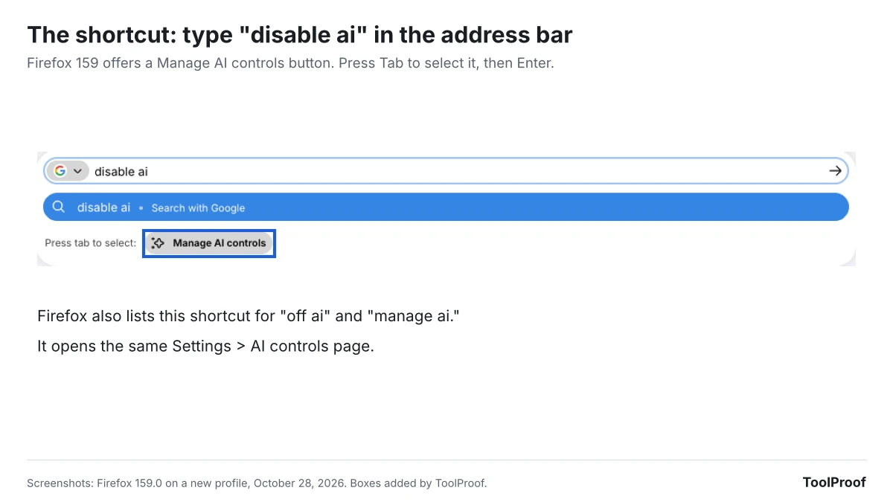

To turn off AI in Firefox, open the menu, choose **Settings**, click **AI controls**, and turn on **Block AI enhancements**, then click **Block** to confirm. In Firefox 159, the version released on October 27, 2026, that one switch blocks translations, the AI chatbot in the sidebar, link preview summaries, tab group suggestions, speech recognition, PDF image descriptions and Smart Window. Firefox also removes any on-device AI models it already downloaded. If you want to keep one feature, set just that one back to **Available**.

We installed Firefox 159 on a new profile on October 28, 2026, and checked what the switch changes on a test page. After we turned it on, the AI chatbot and **Translate Selection** disappeared from the right-click menu, the chatbot icon left the sidebar, and the block was still on after a restart. Some AI is outside the switch's reach: search suggestions and the Perplexity search engine stayed on, and AI answers inside websites, such as Google's AI Overviews, are controlled by those websites.

## Firefox AI features at a glance

Firefox 159's **AI controls** page lists six features on a new profile, and a seventh, Smart Window, once it reaches your copy. The descriptions below follow Firefox's wording on that page, and the last column is what we saw after blocking.

| Feature | What it does | After Block AI enhancements |
| --- | --- | --- |
| Translations | Translates web pages and selected text on your device | Blocked; translation icon and menu item gone |
| Speech recognition | Turns speech into text on your device | Blocked |
| Image alt text in Firefox PDF viewer | Adds descriptions to images you add to PDFs | Blocked |
| Tab group suggestions | Suggests names and groupings for your tabs | Blocked |
| Key points in link previews | Shows a quick summary before you open a link | Blocked |
| Chatbot in sidebar | Puts Claude, ChatGPT, Gemini or Mistral Vibe in the sidebar and right-click menu | Blocked; sidebar icon and menu item gone |
| Smart Window | Firefox's built-in AI assistant window, still rolling out | Listed as blocked in the confirmation window |

The first five are "on-device AI," which Firefox describes as small AI models that download to your computer only if you use the feature. The chatbot sends what you ask to the provider you pick, such as ChatGPT or Claude.

## How to turn off all AI in Firefox

The **Block AI enhancements** switch in **Settings > AI controls** turns off every AI feature Firefox lists, in one step.

1. Click the menu button (three lines) in the top-right corner of Firefox and choose **Settings**. On a Mac, you can also choose **Firefox > Settings** in the menu bar.
2. Click **AI controls** in the left menu.
3. Turn on **Block AI enhancements**.
4. A window titled **Block AI enhancements?** lists what will be blocked. Click **Block**.

There's a faster way to the same page: type **disable ai** in the address bar, press **Tab** to select the **Manage AI controls** button that appears, and press **Enter**. Firefox added this shortcut in version 154, and its built-in keyword list also includes **off ai** and **manage ai**.

After you click **Block**, every feature on the page shows **Blocked**, and Firefox adds a note: "New and current AI enhancements are blocked by default." Mozilla's [guide to AI controls](https://blog.mozilla.org/en/firefox/how-to-use-ai-controls/) says the switch blocks "current and future AI-enhanced features," so a new AI feature added in a later update starts out blocked too.

This is simpler than Chrome, where some AI features can only be hidden in Settings and fully removed only with a Windows policy; our guide to [turning off AI in Chrome](/posts/turn-off-ai-in-chrome) covers each one. On a work or school computer, the switch or a single feature may be grayed out: Firefox locks these settings when your organization manages them with an AI controls policy, so ask your IT team.

## What disappears when you block AI in Firefox?

In our October 2026 test of Firefox 159.0, blocking AI removed two items from the right-click menu, the chatbot icon from the sidebar and the translation icon from the address bar. We opened the same French-language test page before and after, selected a sentence and right-clicked it.

- **Right-click menu:** **Translate Selection to English** and **Ask an AI Chatbot** were gone. **Search Google for** and every other item stayed.
- **Sidebar:** five icons became four. The AI chatbot icon was removed; bookmarks, history, synced tabs and passwords stayed.
- **Address bar:** the translation icon Firefox shows on foreign-language pages no longer appeared.
- **After a restart:** the switch was still on and every feature still showed **Blocked**.

Firefox's AI controls page also says blocked on-device features have their downloaded models "removed." A new profile like ours hadn't downloaded any, so we didn't measure how much space that saves.

## How to keep one AI feature and block the rest

To keep one AI feature, leave **Block AI enhancements** on and change only that feature's menu to **Available**. Firefox treats your choice for that feature as an exception and keeps everything else blocked.

1. Go to **Settings > AI controls** and turn on **Block AI enhancements**, as above.
2. Find the feature you want to keep, such as **Translations**.
3. Open the menu next to it and choose **Available**.

When we set only **Translations** back to **Available**, the translation icon and **Translate Selection to English** returned on our test page, while **Ask an AI Chatbot** and the chatbot icon stayed hidden.

The menus offer different choices. **Translations** had only **Available** and **Blocked**. **Chatbot in sidebar** also listed the four chatbot providers, **Anthropic Claude**, **ChatGPT**, **Google Gemini** and **Mistral Vibe**, so picking one keeps the chatbot and chooses its provider in one step. Each provider in that list is the company's own chat website, such as gemini.google.com, opened in the sidebar, so your chats there follow that company's account and history settings. If you pick Gemini, our guide to [turning off Gemini Apps Activity](/posts/turn-off-gemini-apps-activity) explains how long Google keeps those chats. And if you keep the chatbot, note one change in Firefox 159: its **Summarize page** option now sends the page's address to the chatbot provider instead of the page's text.

You can also do the reverse: leave the main switch off and set only the features you dislike to **Blocked**. The difference is the future. With the main switch off, an AI feature added in a later update starts out available.

## What doesn't Block AI enhancements turn off?

**Block AI enhancements** covers AI features built into Firefox. It doesn't change your search engine, AI inside websites, or extensions that run their own AI.

- **Search suggestions:** After blocking, **Settings > Search > Show search suggestions** was still checked in our test. Firefox's description of the switch calls search suggestions and recommendations "traditional machine learning features" and points to separate controls for them.
- **Perplexity:** Perplexity, an AI answer engine, stayed switched on in **Settings > Search** under **Additional search engines**, next to Google, Bing, DuckDuckGo and Wikipedia. To remove it from the address bar, turn off its switch on that page.
- **AI answers in search results:** AI Overviews and AI Mode come from Google, not Firefox, so blocking AI in Firefox doesn't hide them. Our [guide to turning off AI in Chrome, Gmail, Word and more](/posts/turn-off-ai-features#how-to-turn-off-ai-overviews-and-ai-mode-in-google-search) explains what Google lets you do, which is less than you'd hope.
- **Extensions:** The confirmation window says blocking "also affects extensions that use AI provided by Firefox." An extension that connects to its own AI service isn't covered, so remove it from **Extensions and Themes** if you don't want it.

## How to turn off Smart Window in Firefox

**Block AI enhancements** already blocks Smart Window, even before it reaches your copy of Firefox. On our new profile, Smart Window had no row on the **AI controls** page, but it was on the list in the confirmation window.

Smart Window is a Firefox window with a built-in AI assistant that can group your tabs, summarize and compare pages, and answer questions, according to Mozilla's [Smart Window page](https://www.firefox.com/en-US/smart-window/). Firefox 155 on September 1, 2026, made it available to try for everyone in the US, Canada and France, released gradually. Firefox 158 added suggestions for filling in forms from your open tabs and saved autofill data, and Firefox 159 added watching pages for price drops or restocks.

- **To block only Smart Window:** once it appears on the **AI controls** page, set its row to **Blocked**. Firefox's own text for that step warns that blocking it deletes your Smart Window chats and memories.
- **To keep Smart Window but limit what it remembers:** Mozilla's page says Smart Window's "Memories" are stored on your device, not on Mozilla's servers, and that "you can see what's remembered, delete what doesn't fit or turn it off."

Smart Window wasn't switched on in our copy, so we couldn't open its own settings to confirm the menu names there. Mozilla says Smart Window is desktop-only.

## How to turn off AI in Firefox on Android and iPhone

Firefox for Android and Firefox for iPhone each have their own AI controls, added in version 151 on May 19, 2026. Mozilla's release notes for both apps describe them as "one place to turn them on, off or customize them individually." The phone apps keep their own settings, so check them on your phone too.

In Firefox for Android 159, the app's built-in text describes a page called **AI controls** in **Settings** that lists:

- **Block AI enhancements**, the same all-in-one switch as on a computer
- **Translations**, which the app says "stay private on your device"
- **Page summaries**, which summarize long articles when you tap or shake your phone; the app says "Pages and summaries are never stored," and **More page summary settings** has a **Shake to summarize** switch
- **Voice search**, where the app notes that "Audio is converted to text by Google Speech Services"

We read those labels from the Firefox for Android 159 app file rather than from a phone, so the order on screen may differ. For iPhone, Mozilla's release notes confirm the AI controls page and page summaries with a tap or shake, but we couldn't check where the page sits in the iPhone app's settings.

## FAQ

### How do I turn AI back on in Firefox?

Go to **Settings > AI controls** and turn off **Block AI enhancements**. Firefox's confirmation window says that afterward "you can unblock anything you want to keep using," so you can also leave the switch on and set single features to **Available**, as described above. Firefox says on-device models download when you use the feature, so a model removed by blocking comes back the next time you use it.

### Will a Firefox update turn AI back on?

Firefox's AI controls page says that with **Block AI enhancements** on, "new and current AI enhancements are blocked by default," so new AI features arriving in an update start blocked. We confirmed the setting survived a restart; we couldn't test an update, since Firefox 159 is the newest version.

## Which setting should you use?

- **If you want no AI from Firefox at all:** turn on **Block AI enhancements**, then turn off Perplexity in **Settings > Search**.
- **If you only want translations:** block everything, then set **Translations** to **Available**. Translation runs on your computer.
- **If you use one chatbot:** block everything, then choose your provider in **Chatbot in sidebar**.
- **If you're switching browsers because of AI:** Firefox turns off all its AI with one switch, while Chrome takes several settings and a policy. If you're leaving Arc, which stops working December 22, our look at [Arc's shutdown and the move to Dia](/posts/arc-browser-shutting-down) covers what you can bring with you.

## How we tested

On October 28, 2026, we downloaded Firefox 159.0 for Linux from Mozilla, started it with a new profile in US English, and used it through a virtual screen. We opened **Settings > AI controls**, turned on **Block AI enhancements**, and compared the right-click menu, sidebar and address bar on the same local French-language test page before and after; the "before" sidebar came from a second new profile. We then set **Translations** back to **Available**, restarted Firefox, and checked **Settings > Search**.

We also read Firefox's release notes for desktop versions 148 to 159 and for Android and iPhone versions 148 to 159, Mozilla's February 24, 2026, guide to AI controls, and Mozilla's Smart Window page. The Android menu labels come from the text built into the Firefox for Android 159 app.

Not tested: Firefox on Windows or Mac (the same version, but we checked the Linux build), Smart Window itself, the chatbot and link previews in use, and the Android and iPhone apps on a real phone.
