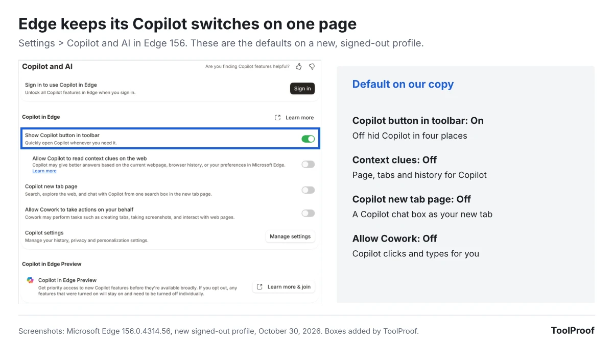
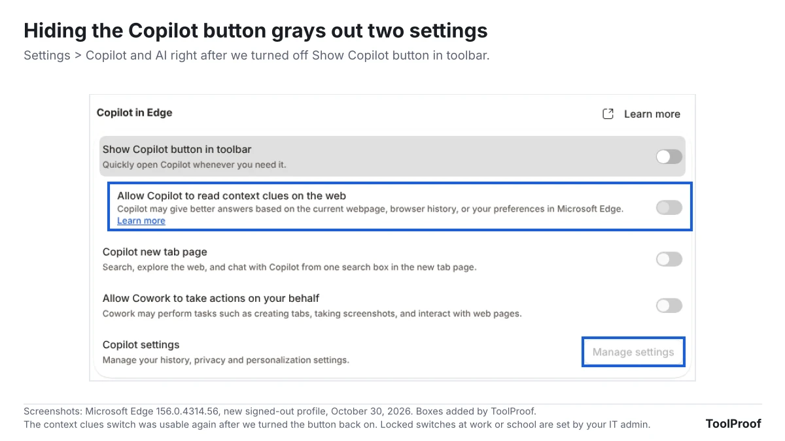

To turn off Copilot in Microsoft Edge, click **Settings and more** (the three dots in the top-right corner), choose **Settings**, select **Copilot and AI**, and turn off **Show Copilot button in toolbar**. In our test of Edge 156, that one switch did more than its name says. It also removed **Summarize with Copilot** from the right-click menu, took the Copilot icon off the small menu that pops up when you select text, and stopped the **Ctrl+Shift+.** shortcut from opening Copilot. Edge has no switch that removes Copilot completely.

We ran Microsoft Edge 156.0.4314.56, the version Microsoft released on October 29, 2026, on a new signed-out profile on October 30, 2026. On the same test page, we checked six places where Copilot can show up, before and after each switch. One Copilot feature survived every switch we tried: **Help me rewrite** in the right-click menu of text boxes stayed even after we also turned off **Use writing assistance**. Our test computer ran Linux, and Microsoft's help pages give the same **Settings > Copilot and AI** path without separate steps for Windows or Mac.

| Switch | Where | Default on our copy | What turning it off does |
| --- | --- | --- | --- |
| Show Copilot button in toolbar | Settings > Copilot and AI | On | Hid the Copilot button, Summarize with Copilot, the mini menu icon and Ctrl+Shift+. (we tested) |
| Allow Copilot to read context clues on the web | Settings > Copilot and AI | Off | Copilot can't use the current page, your open tabs or your browsing history (Microsoft) |
| Copilot new tab page | Settings > Copilot and AI | Off | Keeps the regular new tab page (we tested) |
| Allow Cowork to take actions on your behalf | Settings > Copilot and AI | Off | Copilot can't create tabs, take screenshots or work in web pages for you (Edge's description) |
| Use writing assistance | Settings > Languages | On | Stops the helper that appears at the blinking cursor; Help me rewrite stayed (we tested) |
| Use text prediction | Settings > Languages | On | Stops sending what you type in some text boxes to Microsoft for predictions (Edge's description) |

## How to turn off Copilot in Edge

Turning off Copilot in Edge takes one switch on the **Copilot and AI** page, plus a second page if you also want to stop the writing helper.

1. Click **Settings and more** (**...**) in the top-right corner of Edge, then click **Settings**. You can also type **edge://settings/ai** in the address bar and press **Enter**.
2. Select **Copilot and AI** in the left menu.
3. Turn off **Show Copilot button in toolbar**.
4. Check that **Allow Copilot to read context clues on the web**, **Copilot new tab page** and **Allow Cowork to take actions on your behalf** are off. They were off on our new profile, but they may be on if you have used Copilot while signed in.
5. To stop the writing helper, select **Languages** in the left menu, scroll to **Writing assistance**, and turn off **Use writing assistance**. Turn off **Use text prediction** too if you don't want what you type sent to Microsoft.

You don't need to restart Edge. In our test, the Copilot button disappeared as soon as we flipped the switch, the change applied to pages we opened afterward, and it was still in place after we closed and reopened Edge.

## What the Copilot button switch removes

In Edge 156, turning off **Show Copilot button in toolbar** removed Copilot from four places at once, not only from the toolbar. On our test page, these were gone right after the switch:

- **The Copilot button** in the top-right corner, labeled **Chat** on our copy.
- **Summarize with Copilot** in the menu you get when you right-click a page.
- **The Copilot icon** in the mini menu that pops up when you select text.
- **The Ctrl+Shift+. shortcut.** Before the change, it opened the Copilot pane. After, it did nothing.

Turning the switch back on brought all four back. That makes this switch the closest thing Edge has to a Copilot off switch for people who simply don't want to see it. Microsoft's [getting started guide for Copilot in Edge](https://support.microsoft.com/en-us/edge/copilot/getting-started-with-copilot-in-microsoft-edge) describes the Copilot icon in the upper-right corner as the way to open Copilot and summarize a page, and with the button hidden, none of the other ways we tried opened it.

We also typed a question into the address bar with the button on and off. Both times Edge showed ordinary search suggestions, with no Copilot line, on our signed-out copy.

## Help me rewrite stays after you hide the button

**Help me rewrite**, the writing helper in the right-click menu of text boxes, stayed in Edge 156 after we turned off both **Show Copilot button in toolbar** and **Use writing assistance**. Pressing **Alt+I** inside a text box also still opened the helper. Because we weren't signed in, it only showed a box that said "Sign in to use Writing assistance for drafting and rewriting in Edge."

Edge describes **Use writing assistance** as help "by hovering over the blinking cursor or selecting text in supported text fields," and turning it off also grays out **Show writing hints**, the occasional blue dot at the cursor that points you to the feature. The right-click item and its shortcut are not covered by that description, and none of the six Microsoft help pages about Copilot in Edge that we read mention Help me rewrite or a switch for it. We couldn't test what Help me rewrite does for a signed-in profile with the switch off.

**Use text prediction** sits in the same section and is on by default. Edge's description says that when it's on, "typed characters in certain text boxes on the web are sent to Microsoft Cloud to provide text prediction services." It isn't labeled Copilot, but turn it off if your goal is to keep what you type away from Microsoft's AI services.

## The other Copilot switches in Edge 156

The **Copilot and AI** page has three more switches, and all three were off on our new profile:

- **Allow Copilot to read context clues on the web.** Microsoft's [context clues help page](https://support.microsoft.com/en-us/edge/copilot/how-context-clues-work-copilot-edge) says this lets Copilot use the page address, page title, page content or screenshots, and your browsing history. With it off, Copilot "won't answer questions or perform requests based on your websites or browsing data." Microsoft also says Edge tells you or asks permission, depending on your region, the first time you open Copilot, so check this switch if you have used Copilot before.
- **Copilot new tab page.** When we turned it on, new tabs became a Copilot box that says "Type a link or ask anything." The same switch also appears under **Settings > Start, home, and new tab page**.
- **Allow Cowork to take actions on your behalf.** Edge's description says Cowork "may perform tasks such as creating tabs, taking screenshots, and interact with web pages." Microsoft's help pages we read don't use the name Cowork. They describe a similar agent, [Browse with Copilot](https://support.microsoft.com/en-us/edge/copilot/browse-with-copilot), that clicks, types and moves between tabs for you. Microsoft says it's rolling out to Microsoft 365 Premium subscribers in the US and keeps screenshots of its work for up to 30 days.

Microsoft's [Copilot Journeys page](https://support.microsoft.com/en-us/edge/copilot/copilot-journeys) describes one more switch, **Journeys**, which groups your browsing history into topic cards on the Copilot new tab page. Microsoft says it's off by default, can only be turned on after the Copilot new tab page, and that turning it off "stops data collection right away and deletes information previously stored." It didn't appear on our signed-out copy, even with the Copilot new tab page on.

## Where did Copilot Mode go?

Copilot Mode no longer exists. Microsoft retired it on May 13, 2026, saying in its [Edge blog post](https://blogs.windows.com/msedgedev/2026/05/13/new-updates-to-edge-across-desktop-and-mobile/) that its features are now "built directly into Edge," and Edge 156 has no Copilot Mode switch. The same post says people who had Copilot Mode on keep getting new features early through **Copilot in Edge Preview**, which they can change in Edge's settings.

That matters if you used Copilot Mode. The **Copilot in Edge Preview** card at the bottom of the **Copilot and AI** page warns: "If you opt out, any features that were turned on will stay on and need to be turned off individually." Microsoft's [Preview page](https://explore.microsoft.com/en-us/edge/copilot/preview) lists the Copilot new tab page, Journeys and a page tool called Remix as included features. So after you leave the Preview, go back through the switches above one by one. We weren't in the Preview, so we couldn't see the leave option itself.

## Why a Copilot switch is grayed out

A grayed-out switch in Edge's Copilot settings usually means one of two things.

- **The Copilot button is off.** When we turned off **Show Copilot button in toolbar**, Edge grayed out **Allow Copilot to read context clues on the web** and the **Manage settings** button for Copilot settings. Turn the button back on to change them.
- **Your work or school manages Edge.** Microsoft documents policies that let IT admins control the Copilot toolbar button and Copilot's access to page content for work or school profiles. Its policy pages say these don't apply to profiles signed in with a personal Microsoft account. If Settings shows "Managed by your organization" and a Copilot switch won't move, ask your IT team.

## Which switches should you turn off?

Pick the switches that match what bothers you about Copilot.

- **You don't want to see Copilot:** turn off **Show Copilot button in toolbar**. It covered four of the six places we checked.
- **You don't want Copilot reading your tabs and history:** keep **Allow Copilot to read context clues on the web** off. Microsoft also suggests closing tabs and clearing your browsing history to remove information from what Copilot can use.
- **You don't want what you type sent to Microsoft:** turn off **Use text prediction** and **Use writing assistance** under **Languages**, and know that Help me rewrite stays in the right-click menu.
- **You used Copilot Mode:** leave **Copilot in Edge Preview**, then check each switch, because leaving doesn't turn features off.

Firefox handles this differently: one switch blocks all of its AI features, as our test of [turning off AI in Firefox](/posts/turn-off-ai-in-firefox) shows. Chrome spreads its AI across several pages, covered in our guide to [turning off AI in Chrome](/posts/turn-off-ai-in-chrome). For Copilot inside Word, Excel and PowerPoint, which has its own checkbox, see [how to turn off Copilot in Word](/posts/turn-off-copilot-in-word). And for the rest of your apps, our guide to [turning off AI in Chrome, Gmail, Word and more](/posts/turn-off-ai-features) lists where each switch lives.

## FAQ

### Can you turn off Copilot in Edge on Android or iPhone?

Microsoft's [Journeys help page](https://support.microsoft.com/en-us/edge/copilot/copilot-journeys) gives the same path for the Edge mobile app: **Settings and more (...) > Settings > Copilot and AI**. We couldn't test the phone apps, so we can't say which switches that page has on Android or iPhone.

### Can you uninstall Copilot from Edge?

No. Copilot is built into Edge, and Settings has no option to remove it, only the switches above. On Windows, the separate Copilot app is a different program that you can uninstall; our guide to [turning off AI in Windows 11](/posts/turn-off-ai-in-windows-11) shows how.

## How we tested

- **Browser:** Microsoft Edge 156.0.4314.56 for Linux, Stable channel, which Microsoft's [release notes](https://learn.microsoft.com/en-us/deployedge/microsoft-edge-relnote-stable-channel) date to October 29, 2026. We started each run from a new profile, signed out, in US English, on October 30, 2026.
- **Test page:** a page we made with two paragraphs and a text box, opened on the same computer.
- **Steps, the same in every state:** right-click the page, select a sentence, press **Ctrl+Shift+.**, type a sentence in the text box and right-click it, then press **Alt+I** in the text box. We also typed a question in the address bar.
- **States:** default; **Show Copilot button in toolbar** off; that switch plus **Use writing assistance** off; and the button switched off and back on. To check that the changes stick, we repeated the first three with Edge closed and reopened after each change.
- **What we couldn't test:** anything that needs a Microsoft account, including chatting with Copilot, Journeys, context clues in use, Cowork and what Help me rewrite does after sign-in. We also didn't test Edge on Windows, Mac or phones.
- **What we left out:** Group Policy and registry changes. Microsoft's Copilot policies are meant for IT admins managing work or school profiles.

Microsoft plans to release Edge 157 in the week of November 5, 2026, according to its [release schedule](https://learn.microsoft.com/en-us/deployedge/microsoft-edge-release-schedule). We'll check these switches again after it ships.
