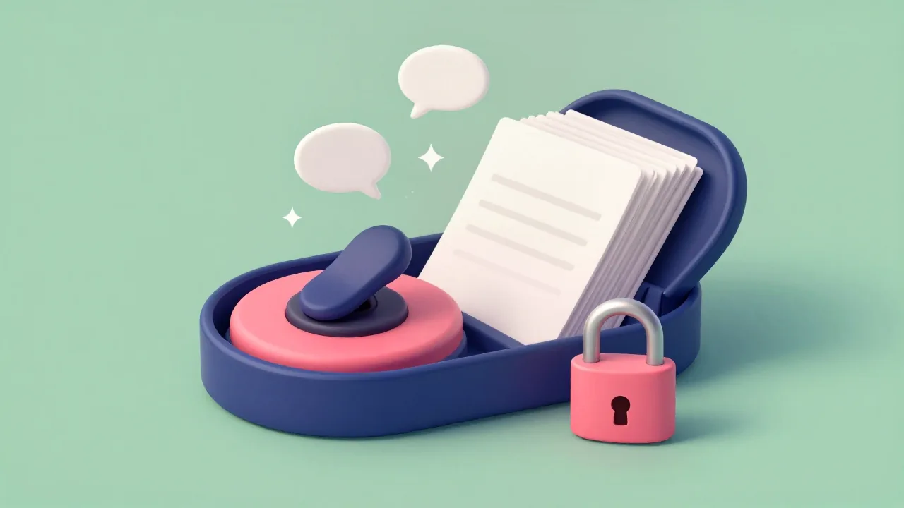
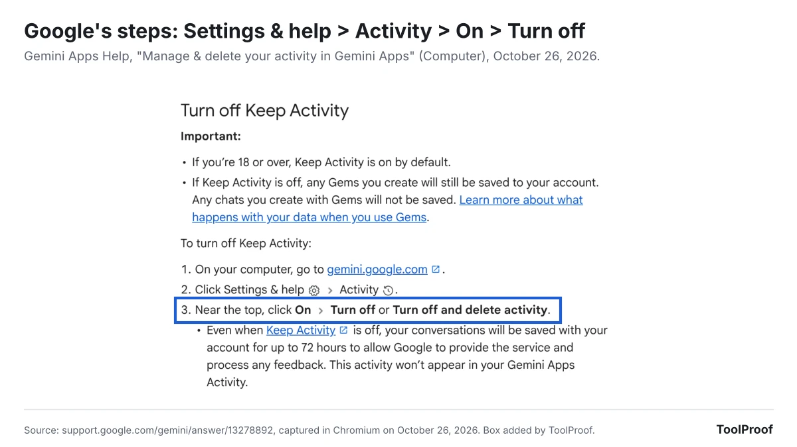
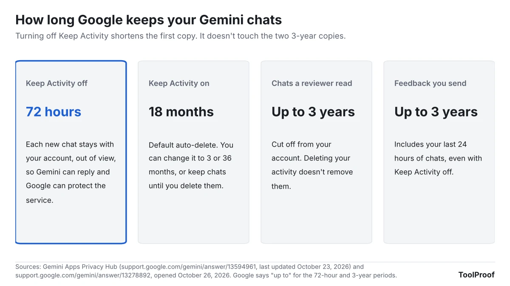

To turn off Gemini Apps Activity, go to gemini.google.com, click **Settings & help > Activity**, then click **On** near the top and choose **Turn off** or **Turn off and delete activity**. In the Gemini app on Android or iPhone, tap **Menu**, then your profile picture, then **Gemini Apps Activity**, and use the same **On** button. Google renamed the switch itself **Keep Activity** in 2025, while the page and menu still say Gemini Apps Activity.

Turning it off stops new chats from being saved to your history and from being used to train Google's AI, unless you send feedback. It also switches off your recent chats list, Memory of past chats, Personal Intelligence, skills, Tasks and most Connected Apps. Google still keeps each new chat for up to 72 hours, and chats a human reviewer already read stay for up to three years, even after you delete your activity.

On October 26, 2026, we read 13 Gemini help pages, including the Gemini Apps Privacy Hub (last updated October 23, 2026) and its collapsed sections, and listed what each says happens when Keep Activity is off. We don't have a Google account in our test setup, so the steps come from Google's pages, not our own screens.

| Where you use Gemini | Where the switch is | Then |
| --- | --- | --- |
| Computer (gemini.google.com) | **Settings & help > Activity** | **On > Turn off** |
| Gemini app on Android | **Menu >** your profile picture **> Gemini Apps Activity** | **On > Turn off** |
| Gemini app on iPhone or iPad | **Menu >** your profile picture **> Gemini Apps Activity** | **On > Turn off** |
| Any browser | myactivity.google.com/product/gemini | **On > Turn off** |

## How to turn off Gemini Apps Activity on a computer

On a computer, the switch is on the Activity page at gemini.google.com, under **Settings & help**. Google's [activity help page](https://support.google.com/gemini/answer/13278892?hl=en&co=GENIE.Platform%3DDesktop) lists these steps:

1. Go to [gemini.google.com](https://gemini.google.com) and sign in.
2. Click **Settings & help**, then **Activity**. You can also go straight to [myactivity.google.com/product/gemini](https://myactivity.google.com/product/gemini).
3. Near the top, click **On**.
4. Choose **Turn off** to stop saving new chats, or **Turn off and delete activity** to also clear what's already saved.

The same page says Keep Activity is on by default if you're 18 or over, so most adult accounts start with it on.

## How to turn off Gemini Apps Activity on Android or iPhone

In the Gemini app on Android, iPhone or iPad, the switch is behind your profile picture, in **Gemini Apps Activity**. Google's Android and iPhone versions of the help page give the same steps:

1. Open the Gemini app.
2. At the left, tap **Menu**, then your profile picture or initial.
3. Tap **Gemini Apps Activity**.
4. Near the top, tap **On**, then **Turn off** or **Turn off and delete activity**.

If you use Gemini in your phone's browser instead of the app, go to gemini.google.com and tap **Menu > Settings & help > Activity**, then follow step 4.

## Gemini Apps Activity and Keep Activity are the same setting

Keep Activity is the new name for the Gemini Apps Activity switch. Google's [August 13, 2025 announcement](https://blog.google/products-and-platforms/products/gemini/temporary-chats-privacy-controls/) said the "Gemini Apps Activity" setting would be renamed "Keep Activity" in the following weeks. As of October 26, 2026, Google's own help pages still use both names: the page and the app menu are called Gemini Apps Activity, and the switch on that page is Keep Activity. Older guides that tell you to turn off "Gemini Apps Activity" describe the same control.

## Turn off or Turn off and delete activity?

**Turn off and delete activity** also clears the Gemini chats already saved in your history, while plain **Turn off** only stops new ones from being saved and leaves the rest for you or auto-delete to remove later. To delete saved activity at any time, open the same Activity page and click **Delete**, then pick **All time**, **Last hour**, **Last day** or **Custom range**. You can also delete a single day or a single chat next to it.

Deleting has limits that Google spells out on the [activity page](https://support.google.com/gemini/answer/13278892?hl=en&co=GENIE.Platform%3DDesktop) and in the [Privacy Hub](https://support.google.com/gemini/answer/13594961?hl=en):

- Deleting a chat with a Gem doesn't delete the Gem itself.
- Deleting a chat you shared doesn't delete its public link. You remove those separately in **Your Public Links**.
- Chats a human reviewer already read aren't deleted. They're kept for up to three years, disconnected from your account.
- Data in other Google services stays. Turning off Keep Activity doesn't change Web & App Activity, Search Services History or Timeline, which may keep saving location and other data as you use those services.

## What stops working when Keep Activity is off

With Keep Activity off, Gemini still answers your questions, but the features that build on your saved history stop: the recent chats list, Memory, Personal Intelligence, skills, Tasks and most Connected Apps. We matched each feature to the Google page that lists Keep Activity as a requirement.

- **Recent chats.** Google's [recent chats page](https://support.google.com/gemini/answer/13666746?hl=en&co=GENIE.Platform%3DDesktop) says finding, searching, pinning and renaming chats on a personal account work only with Keep Activity on.
- **Memory and Personal Intelligence.** Gemini's [memory of past chats](https://support.google.com/gemini/answer/16598469?hl=en&co=GENIE.Platform%3DDesktop) and [Personal Intelligence](https://support.google.com/gemini/answer/16598406?hl=en&co=GENIE.Platform%3DDesktop), which draws on Gmail, Photos and other Google apps, both say "This feature isn't available when this setting is off." That includes the personal answers covered in our guide to [Gemini on Android Auto with Personal Intelligence](/posts/gemini-android-auto-personal-intelligence).
- **Skills and Tasks.** Google's [skills page](https://support.google.com/gemini/answer/17094296?hl=en&co=GENIE.Platform%3DDesktop) lists Keep Activity as a requirement, and the Privacy Hub says Tasks, which use a remote browser or computer, work only with it on. Our guide to [moving Gemini Gems to skills](/posts/gemini-gems-to-skills) covers the rest of the skills requirements.
- **Connected Apps.** Google's [Connected Apps page](https://support.google.com/gemini/answer/13695044?hl=en&co=GENIE.Platform%3DDesktop) says that with Keep Activity off, no Connected Apps work on gemini.google.com, iPhone or iPad, or smartwatches. On Android, only Device assistance, Phone, Messages and WhatsApp keep working. Turning Keep Activity back on restores the apps you had connected. Our look at [Gemini's Customize menu and its 83 Connected Apps](/posts/gemini-connected-apps) lists the apps this affects.
- **Maps, Flights, Hotels and YouTube.** Gemini uses public information from these four only when Keep Activity is on. It can always use Google Search, even with the setting off or when you're signed out.
- **Gems.** Your Gems stay saved, but chats you have with a Gem aren't saved. Adding Drive files to a Gem also needs Keep Activity on, according to Google's [Gems page](https://support.google.com/gemini/answer/15146780?hl=en&co=GENIE.Platform%3DDesktop).

Google's pages disagree on one detail. The activity page lists five apps that stay available with Keep Activity off, including Gemini Notebook. The Connected Apps page and the Privacy Hub list only the four Android apps and leave Gemini Notebook out. If you rely on Gemini Notebook, check it after you switch.

## What Google still keeps after you turn it off

Turning off Keep Activity doesn't make Gemini forget right away: Google keeps each new chat with your account for up to 72 hours, out of your view. The [Privacy Hub](https://support.google.com/gemini/answer/13594961?hl=en) says Gemini uses the last 24 hours of a chat as context to answer you, and Google keeps the 72-hour copy to protect the service, for example in case of a system failure. These chats aren't used to train Google's AI models unless you send feedback.

- **Feedback brings your recent chats with it.** The **Good response** and **Bad response** buttons under each answer are how you give feedback, according to Google's [feedback page](https://support.google.com/gemini/answer/13275746?hl=en&co=GENIE.Platform%3DDesktop). With Keep Activity off, sending feedback means Google collects it along with the last 24 hours of your chats and anything in them, like uploads and data from Connected Apps. Trained teams review it, and Google keeps it for up to three years, disconnected from your account.
- **Human review for safety continues.** Google says that even with Keep Activity off, it uses your chats to respond to you and to help protect Google, its users and the public, "including with help from human reviewers." Turning the setting off stops your future chats from being reviewed to improve Google's AI.
- **Gemini outside the app may save elsewhere.** When Google Assistant powers a feature outside the Gemini app, Google says that activity goes to Web & App Activity instead. Gemini for Home has its own recording setting in Google Home History.

## Middle options: auto-delete and temporary chats

If you want Gemini's history features but less saved data, shorten auto-delete to 3 months, or use a temporary chat for questions you don't want kept. Both leave Keep Activity on, so Memory, skills and Connected Apps keep working.

- **Auto-delete.** On the Activity page, click **Deleting activity older than … months** or **Choose an auto-delete option**, then pick 3, 18 or 36 months or **Don't auto-delete activity**. The default is 18 months. Chats you keep are still used to improve Google's AI while Keep Activity is on.
- **Temporary chat.** On gemini.google.com, click **Temporary chat** next to **New chat**. Google's [Gemini Apps page](https://support.google.com/gemini/answer/13275745?hl=en&co=GENIE.Platform%3DDesktop) says a temporary chat doesn't appear in your activity or recent chats, and the Privacy Hub says it isn't used to train Google's AI and is kept for 72 hours. You can't use Gems, Connected Apps that need Keep Activity, personalization or feedback in one. It works only on personal accounts in the Gemini web and mobile apps, not in Gemini in Chrome or Google Messages.
- **Audio and Gemini Live recordings.** A separate box, **Improve Google services with your audio and Gemini Live videos & screenshares**, is off by default. You can only turn it on while Keep Activity is on, so leaving it unchecked keeps those recordings out of AI training.

## Work and school accounts

On a work or school Google account, you can't turn off Keep Activity yourself; only your Workspace administrator can. Google's [work and school activity section](https://support.google.com/gemini/answer/14620100?hl=en) says it's on by default and history is kept for 18 months, and the administrator can change auto-delete to 3, 18 or 36 months or turn history off altogether.

## FAQ

### Why can't I turn on Gemini Apps Activity?

Google's pages name two reasons. You have to be signed in to Gemini to manage the setting, and on a work or school account the administrator controls it, so you won't be able to change it or see how long your chats are kept.

### Does turning off Gemini Apps Activity turn off Gemini?

No. Keep Activity only controls what Gemini saves. To stop Gemini from opening on an Android phone, Google's [Gemini on Android page](https://support.google.com/gemini/answer/16938321?hl=en) lists other settings: turn off **Hey Google** in the Gemini app under **Settings > Talk to Gemini hands-free**, change what the power button does in your phone's **Settings > System > Gestures**, or pick a different assistant under **Settings > Apps > Default apps > Digital assistant app**. Menu names vary by phone maker.

## Which setting should you use?

- **You want Gemini to keep as little as possible:** choose **Turn off and delete activity**, don't use the feedback buttons, and check Web & App Activity separately in your Google Account.
- **You use Memory, skills or Gmail through Gemini:** leave Keep Activity on, set auto-delete to 3 months, and open a temporary chat for anything sensitive.
- **You only want your chats out of AI training:** there's no separate switch for text chats, because Keep Activity controls both history and training. Temporary chats are the way to keep single conversations out of training while history stays on.
- **You use a work or school account:** ask your administrator. The setting isn't yours to change.

Keep Activity covers the Gemini app only. Gemini inside Gmail and Docs runs on separate Workspace settings, which our guide to [turning off Gemini in Gmail](/posts/turn-off-gemini-in-gmail) maps feature by feature, and our [guide to turning off AI in Chrome, Gmail, Word and more](/posts/turn-off-ai-features) collects the switches for other products.

## How we checked

- **Google pages** (opened October 26, 2026, rendered in Chromium with collapsed sections expanded): Gemini Apps Help, [Manage & delete your activity in Gemini Apps](https://support.google.com/gemini/answer/13278892?hl=en&co=GENIE.Platform%3DDesktop) (Computer, Android and iPhone versions), [Gemini Apps Privacy Hub](https://support.google.com/gemini/answer/13594961?hl=en), [Use & manage Connected Apps in Gemini](https://support.google.com/gemini/answer/13695044?hl=en&co=GENIE.Platform%3DDesktop), [Get personalization with memory of your past Gemini chats](https://support.google.com/gemini/answer/16598469?hl=en&co=GENIE.Platform%3DDesktop), [Connect your Google apps to personalize your Gemini experience](https://support.google.com/gemini/answer/16598406?hl=en&co=GENIE.Platform%3DDesktop), [About personalization with Connected Apps](https://support.google.com/gemini/answer/16836988?hl=en), [Create & manage skills for Gemini Apps](https://support.google.com/gemini/answer/17094296?hl=en&co=GENIE.Platform%3DDesktop), [Use Gems in Gemini Apps](https://support.google.com/gemini/answer/15146780?hl=en&co=GENIE.Platform%3DDesktop), [Find & manage your recent chats in Gemini Apps](https://support.google.com/gemini/answer/13666746?hl=en&co=GENIE.Platform%3DDesktop), [Use Gemini Apps](https://support.google.com/gemini/answer/13275745?hl=en&co=GENIE.Platform%3DDesktop), [Send feedback or report a problem with Gemini Apps](https://support.google.com/gemini/answer/13275746?hl=en&co=GENIE.Platform%3DDesktop), [Manage or delete the Gemini app on your Android device](https://support.google.com/gemini/answer/16938321?hl=en) and the activity section of [Use Gemini Apps with a work or school Google Account](https://support.google.com/gemini/answer/14620100?hl=en)
- **Google blog**: [Gemini adds Temporary Chats and new personalization features](https://blog.google/products-and-platforms/products/gemini/temporary-chats-privacy-controls/), August 13, 2025, for the rename
- **Not checked**: we couldn't open Gemini's Activity page without a Google account, so we couldn't confirm the exact on-screen position of the **On** button or test which Connected Apps respond with Keep Activity off. Google's pages don't say what the default is for accounts under 18
