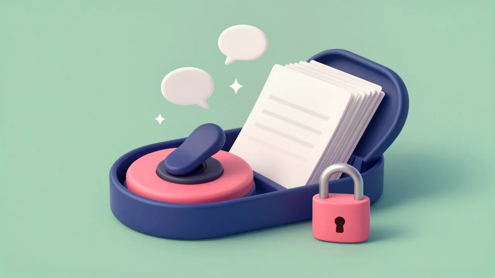
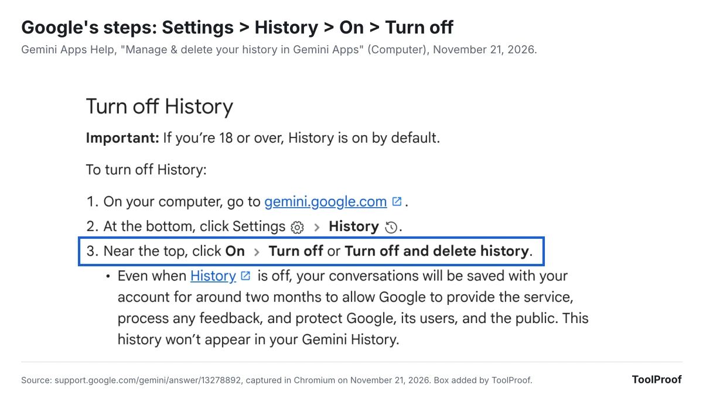
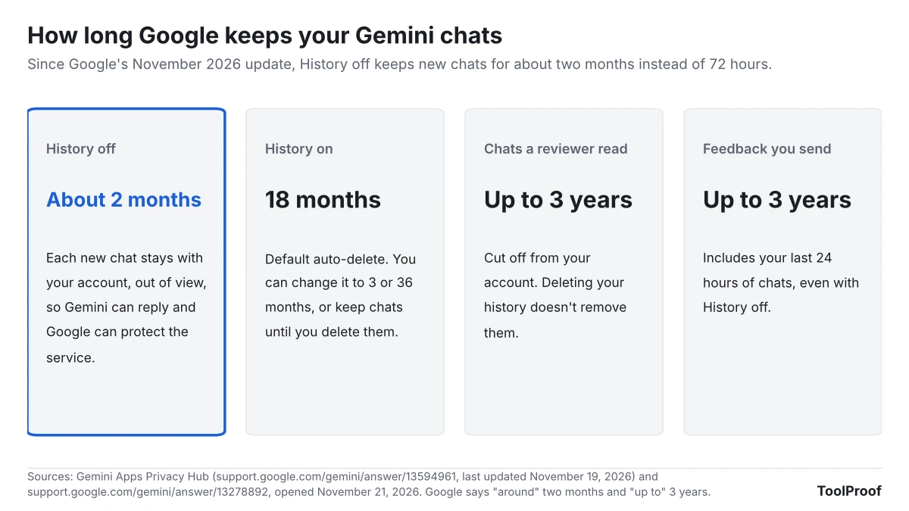

To turn off Gemini Apps Activity, go to gemini.google.com, click **Settings > History** at the bottom of the sidebar, then click **On** near the top and choose **Turn off** or **Turn off and delete history**. In the Gemini app on Android or iPhone, tap **Menu**, then your profile picture, then **Gemini History**, and use the same **On** button. Google renamed the setting **History** in November 2026; before that it was called **Keep Activity**, and until 2025, **Gemini Apps Activity**.

Turning History off stops new chats from appearing in your history and from being used to train Google's AI, unless you send feedback. It also switches off your recent chats list, Memory of past chats, Personal Intelligence, Tasks and most Connected Apps. Google still keeps each new chat for around two months, up from 72 hours before the change, and chats a human reviewer already read stay for up to three years, even after you delete them. If you only want your chats kept out of AI training, you no longer have to turn History off: uncheck **Chat content including text & attachments** on the same page instead.

On November 21, 2026, we read Google's November 16 announcement of the change and rechecked the 13 Gemini help pages this guide is built on, including the Gemini Apps Privacy Hub (last updated November 19, 2026) and its collapsed sections. We don't have a Google account in our test setup, so the steps come from Google's pages, not our own screens.

| Where you use Gemini | Where the setting is | Then |
| --- | --- | --- |
| Computer (gemini.google.com) | **Settings > History** | **On > Turn off** |
| Gemini app on Android | **Menu >** your profile picture **> Gemini History** | **On > Turn off** |
| Gemini app on iPhone or iPad | **Menu >** your profile picture **> Gemini History** | **On > Turn off** |
| Any browser | myactivity.google.com/product/gemini | **On > Turn off** |

## How to turn off Gemini Apps Activity on a computer

On a computer, the switch is on the History page at gemini.google.com, under **Settings** at the bottom of the sidebar. Google's [history help page](https://support.google.com/gemini/answer/13278892?hl=en&co=GENIE.Platform%3DDesktop) lists these steps:

1. Go to [gemini.google.com](https://gemini.google.com) and sign in.
2. At the bottom, click **Settings**, then **History**. You can also go straight to [myactivity.google.com/product/gemini](https://myactivity.google.com/product/gemini).
3. Near the top, click **On**.
4. Choose **Turn off** to stop saving new chats to your history, or **Turn off and delete history** to also clear what's already saved.

The same page says History is on by default if you're 18 or over, so most adult accounts start with it on. Google said on November 16, 2026 that it would roll the new settings out globally "in the coming weeks," so your account may still show the older labels for a while: **Settings & help > Activity** on the web, **Gemini Apps Activity** in the app, and a switch called **Keep Activity**. The **On > Turn off** step was the same under the old names when we checked on November 7, 2026.

## How to turn off Gemini Apps Activity on Android or iPhone

In the Gemini app on Android, iPhone or iPad, the switch is behind your profile picture, in **Gemini History**. Google's Android and iPhone versions of the help page give the same steps:

1. Open the Gemini app.
2. At the left, tap **Menu**, then your profile picture or initial.
3. Tap **Gemini History**.
4. Near the top, tap **On**, then **Turn off** or **Turn off and delete history**.

If you use Gemini in your phone's browser instead of the app, go to gemini.google.com and tap **Menu > Settings > History**, then follow step 4.

## How to keep your History but stop AI training

Since Google's November 2026 update, a checkbox called **Chat content including text & attachments** on the History page decides whether your chats train Google's AI, separately from whether they're saved. Google's [announcement](https://blog.google/innovation-and-ai/products/gemini-app/updated-controls/) says the new settings "let you keep your Gemini chat history, while opting out of generative AI model training." The help page says the box is on by default if you're over 18, and you can only turn it on while History is on.

1. On gemini.google.com, click **Settings > History**. In the Gemini app, tap **Menu**, then **Settings** at the bottom, then **History** under **Data & privacy**.
2. Uncheck **Chat content including text & attachments**. In the steps on the same page, Google labels this box **Chat content including text & uploads**.
3. Click or tap **Turn off**.

The box has limits that Google spells out in the [Privacy Hub](https://support.google.com/gemini/answer/13594961?hl=en):

- **Feedback still counts.** With the box off, your future chats aren't used to train generative AI models "unless you provide feedback."
- **Review continues.** Google says your chats "will be reviewed and used to improve Google services in other ways," and to protect Google, its users and the public.
- **Reviewed chats stay.** Chats a reviewer already read, and related data, are kept for up to three years, even if you delete them or turn the setting off later.
- **Audio has its own box.** A second box, **Audio and Gemini Live videos & screenshares**, is off by default. Leaving it off doesn't keep all of a Live chat out of training. Google says that if the chat content box is on, it still trains on "transcripts of your chats with Gemini Live and attachments you share with it."

## Gemini History, Keep Activity and Gemini Apps Activity are the same setting

History is the newest name for the setting that used to be called Keep Activity and, before that, Gemini Apps Activity. Google's [August 13, 2025 announcement](https://blog.google/products-and-platforms/products/gemini/temporary-chats-privacy-controls/) renamed "Gemini Apps Activity" to "Keep Activity," and its November 16, 2026 update introduced the History setting and moved AI training into its own checkbox. As of November 21, 2026, Google's help pages still mix the names: the history page and the Privacy Hub say History, while the Memory, Personal Intelligence, skills and temporary chat pages still say Keep Activity or Gemini Apps Activity. Older guides that tell you to turn off "Gemini Apps Activity" describe the same control.

## Turn off or Turn off and delete history?

**Turn off and delete history** also clears the Gemini chats already saved in your history, while plain **Turn off** only stops new ones from being saved and leaves the rest for you or auto-delete to remove later. To delete saved history at any time, open the same History page and click **Delete**, then pick **All time**, **Last hour**, **Last day** or **Custom range**. You can also delete a single day or a single item next to it.

Deleting has limits that Google spells out on the [history page](https://support.google.com/gemini/answer/13278892?hl=en&co=GENIE.Platform%3DDesktop) and in the [Privacy Hub](https://support.google.com/gemini/answer/13594961?hl=en):

- Deleting a chat you shared doesn't delete its public link. You remove those separately in **Your Public Links**.
- Chats a human reviewer already read aren't deleted. They're kept for up to three years, disconnected from your account.
- Data in other Google services stays. Turning off History doesn't change Web & App Activity, Search Services History or Timeline, which may keep saving location and other data as you use those services.
- Deleting history doesn't delete what Gemini's remote browser stored for Tasks, such as website sign-in cookies, or texts you exchanged with Gemini in your messaging app.

## What stops working when History is off

With History off, Gemini still answers your questions, but the features that build on your saved history stop: the recent chats list, Memory, Personal Intelligence, Tasks and most Connected Apps. Skills keep working with less reach. We matched each feature to the Google page that lists the setting as a requirement.

![Table comparing Gemini with History on and off: the recent chats list, Memory and Personal Intelligence, and Tasks are not available when off; skills work but can't reach Calendar, Drive or other Connected Apps; Connected Apps are limited to Phone, Messages, WhatsApp and Device assistance on Android and none on the web, iPhone or watch; Maps, Flights, Hotels and YouTube info is not used; chats are not used for AI training unless you send feedback, and with History on they are used only if the Chat content box is checked](./images/turn-off-gemini-apps-activity/gemini-history-on-vs-off.webp)

- **Recent chats.** Google's [recent chats page](https://support.google.com/gemini/answer/13666746?hl=en&co=GENIE.Platform%3DDesktop) says finding, searching, pinning and renaming chats on a personal account work only with History on.
- **Memory and Personal Intelligence.** Gemini's [memory of past chats](https://support.google.com/gemini/answer/16598469?hl=en&co=GENIE.Platform%3DDesktop) and [Personal Intelligence](https://support.google.com/gemini/answer/16598406?hl=en&co=GENIE.Platform%3DDesktop), which draws on Gmail, Photos and other Google apps, both say "This feature isn't available when this setting is off." That includes the personal answers Gemini gives in Android Auto, covered in our guide to [Google Personal Intelligence settings](/posts/google-gmail-photos-ads).
- **Tasks.** The Privacy Hub says Tasks, which use a remote browser or computer, are "only available when History is on."
- **Skills.** Google's [skills page](https://support.google.com/gemini/answer/17094296?hl=en&co=GENIE.Platform%3DDesktop) now says skills work with the setting off, but they can't use features that need it, such as Google Calendar and Google Drive. Our guide to [moving Gemini Gems to skills](/posts/gemini-gems-to-skills) covers the rest of the skills requirements.
- **Connected Apps.** Google's [Connected Apps page](https://support.google.com/gemini/answer/13695044?hl=en&co=GENIE.Platform%3DDesktop) says that with History off, no Connected Apps work on gemini.google.com, iPhone or iPad, or smartwatches. On Android, only Device assistance, Phone, Messages and WhatsApp keep working. Turning History back on restores the apps you had connected. Our look at [Gemini's Customize menu and its 90 Connected Apps](/posts/gemini-connected-apps) lists the apps this affects.
- **Maps, Flights, Hotels and YouTube.** Gemini uses public information from these four only when History is on. It can always use Google Search, even with the setting off or when you're signed out.
- **Gems.** Adding Drive files to a Gem needs History on, according to Google's [Gems page](https://support.google.com/gemini/answer/15146780?hl=en&co=GENIE.Platform%3DDesktop).

Google's pages disagree on one detail. The history page lists five apps that stay available with History off, including Gemini Notebook. The Connected Apps page lists only the four Android apps and leaves Gemini Notebook out. If you rely on Gemini Notebook, check it after you switch.

## What Google still keeps after you turn it off

Turning off History doesn't make Gemini forget right away. Google keeps each new chat with your account for around two months, out of your view. Before the November 2026 update, that period was up to 72 hours. The [Privacy Hub](https://support.google.com/gemini/answer/13594961?hl=en) says Gemini uses the last 24 hours of a chat as context to answer you, and Google keeps the two-month copy to protect the service, for example in case of a system failure. Google's announcement calls the longer period a change "to help make Gemini safer." These chats aren't used to train Google's AI models unless you send feedback.

- **Feedback brings your recent chats with it.** The **Good response** and **Bad response** buttons under each answer are how you give feedback, according to Google's [feedback page](https://support.google.com/gemini/answer/13275746?hl=en&co=GENIE.Platform%3DDesktop). With History off, sending feedback means Google collects it along with the last 24 hours of your chats and anything in them, like attachments and data from Connected Apps. Trained teams review it, and Google keeps it for up to three years, disconnected from your account.
- **Human review for safety continues.** Google says that regardless of your settings, it uses your chats to respond to you and to help protect Google, its users and the public, "including with help from human reviewers."
- **Other Google settings keep their own data.** The Privacy Hub says changing your Gemini settings doesn't change other Google settings, so Search Services History, Web & App Activity and Timeline may keep saving data as you use other Google services. Gemini for Home has its own recording setting in Google Home History.

## Middle options: auto-delete and temporary chats

If you want Gemini's history features but less saved data, shorten auto-delete to 3 months, or use a temporary chat for questions you don't want kept in your history. Both leave History on, so Memory, Tasks and Connected Apps keep working.

- **Auto-delete.** On the History page, click **Deleting history older than … months** or **Choose an auto-delete option**, then pick 3, 18 or 36 months or **Don't auto-delete history**. The default is 18 months.
- **Temporary chat.** On gemini.google.com, click **Temporary chat** next to **New chat**. Google's [Gemini Apps page](https://support.google.com/gemini/answer/13275745?hl=en&co=GENIE.Platform%3DDesktop) says a temporary chat doesn't appear in your history or recent chats, and the Privacy Hub says it isn't used to train Google's AI. Google now keeps temporary chats for around two months too, the same as chats with History off. You can't use Gems, Connected Apps that need History, personalization or feedback in one. It works only on personal accounts in the Gemini web and mobile apps, not in Gemini in Chrome or Google Messages.

## Work and school accounts

On a work or school Google account, you can't turn off History yourself; only your Workspace administrator can. Google's [work and school history section](https://support.google.com/gemini/answer/14620100?hl=en) says it's on by default and history is kept for 18 months, and the administrator can change auto-delete to 3, 18 or 36 months or turn history off altogether.

## FAQ

### Why can't I turn on Gemini Apps Activity?

Google's pages name two reasons. You have to be signed in to Gemini to manage the setting, and on a work or school account the administrator controls it, so you won't be able to change it or see how long your chats are kept.

### Why can't I check the Chat content box?

The **Chat content** and **Audio and Gemini Live videos & screenshares** boxes only work while History is on. Google's history page says that if you can't check either box, "you may need to turn History on."

### Does turning off Gemini Apps Activity turn off Gemini?

No. History only controls what Gemini saves. To stop Gemini from opening on an Android phone, Google's [Gemini on Android page](https://support.google.com/gemini/answer/16938321?hl=en) lists other settings: turn off **Hey Google** in the Gemini app under **Settings > Talk to Gemini hands-free**, change what the power button does in your phone's **Settings > System > Gestures**, or pick a different assistant under **Settings > Apps > Default apps > Digital assistant app**. Menu names vary by phone maker. Our guide to [turning off Gemini on an Android phone](/posts/turn-off-gemini-on-android-phone) covers each of these, plus the side button on Samsung phones.

## Which setting should you use?

- **You want Gemini to keep as little as possible:** choose **Turn off and delete history**, don't use the feedback buttons, and check Web & App Activity separately in your Google Account. Google will still hold new chats for around two months.
- **You want your history but not AI training:** leave History on and uncheck **Chat content including text & attachments**. Until that box reaches your account, temporary chats are the way to keep single conversations out of training while history stays on.
- **You use Memory, Tasks or Gmail through Gemini:** leave History on, set auto-delete to 3 months, and open a temporary chat for anything sensitive.
- **You use a work or school account:** ask your administrator. The setting isn't yours to change.

History covers the Gemini app only. Gemini inside Gmail and Docs runs on separate Workspace settings, which our guide to [turning off Gemini in Gmail](/posts/turn-off-gemini-in-gmail) maps feature by feature, and our [guide to turning off AI in Chrome, Gmail, Word and more](/posts/turn-off-ai-features) collects the switches for other products.

## How we checked

- **Google pages** (opened October 26, 2026, rendered in Chromium with collapsed sections expanded): Gemini Apps Help, [Manage & delete your history in Gemini Apps](https://support.google.com/gemini/answer/13278892?hl=en&co=GENIE.Platform%3DDesktop) (Computer, Android and iPhone versions; called "Manage & delete your activity in Gemini Apps" until November 2026), [Gemini Apps Privacy Hub](https://support.google.com/gemini/answer/13594961?hl=en), [Use & manage Connected Apps in Gemini](https://support.google.com/gemini/answer/13695044?hl=en&co=GENIE.Platform%3DDesktop), [Get personalization with memory of your past Gemini chats](https://support.google.com/gemini/answer/16598469?hl=en&co=GENIE.Platform%3DDesktop), [Connect your Google apps to personalize your Gemini experience](https://support.google.com/gemini/answer/16598406?hl=en&co=GENIE.Platform%3DDesktop), [About personalization with Connected Apps](https://support.google.com/gemini/answer/16836988?hl=en), [Create & manage skills for Gemini Apps](https://support.google.com/gemini/answer/17094296?hl=en&co=GENIE.Platform%3DDesktop), [Use Gems in Gemini Apps](https://support.google.com/gemini/answer/15146780?hl=en&co=GENIE.Platform%3DDesktop), [Find & manage your recent chats in Gemini Apps](https://support.google.com/gemini/answer/13666746?hl=en&co=GENIE.Platform%3DDesktop), [Use Gemini Apps](https://support.google.com/gemini/answer/13275745?hl=en&co=GENIE.Platform%3DDesktop), [Send feedback or report a problem with Gemini Apps](https://support.google.com/gemini/answer/13275746?hl=en&co=GENIE.Platform%3DDesktop), [Manage or delete the Gemini app on your Android device](https://support.google.com/gemini/answer/16938321?hl=en) and the history section of [Use Gemini Apps with a work or school Google Account](https://support.google.com/gemini/answer/14620100?hl=en)
- **First recheck** (November 7, 2026): the activity steps and the Android and iPhone app steps were unchanged, four pages had relabeled **Settings & help** as **Settings**, and the Privacy Hub (then last updated October 26, 2026) added sections on sharing your avatar and on Memory summary and dropped its answer on where Google Assistant activity is saved, so we replaced the sentence that relied on it
- **Second recheck** (November 21, 2026): we opened all 13 pages again after Google's update. The history page had renamed Keep Activity to History, moved it to **Settings > History**, changed the time chats are kept with it off from up to 72 hours to around two months, added the **Chat content** checkbox and dropped its notes on Gems. The Privacy Hub (last updated November 19, 2026) made the same changes and now gives temporary chats the same two-month period. The skills page now says skills work with the setting off. We rewrote the steps, the feature list and the retention section, and redrew the three charts
- **Google blog**: [Gemini adds Temporary Chats and new personalization features](https://blog.google/products-and-platforms/products/gemini/temporary-chats-privacy-controls/), August 13, 2025, for the first rename, and [Gemini app updates: New chat history and training controls](https://blog.google/innovation-and-ai/products/gemini-app/updated-controls/), November 16, 2026, for History, the training controls and the two-month period
- **Not checked**: we couldn't open Gemini's History page without a Google account, so we couldn't confirm the exact on-screen position of the **On** button, see when the new settings reach a given account, or test which Connected Apps respond with History off. Google's pages don't say what the default is for accounts under 18
