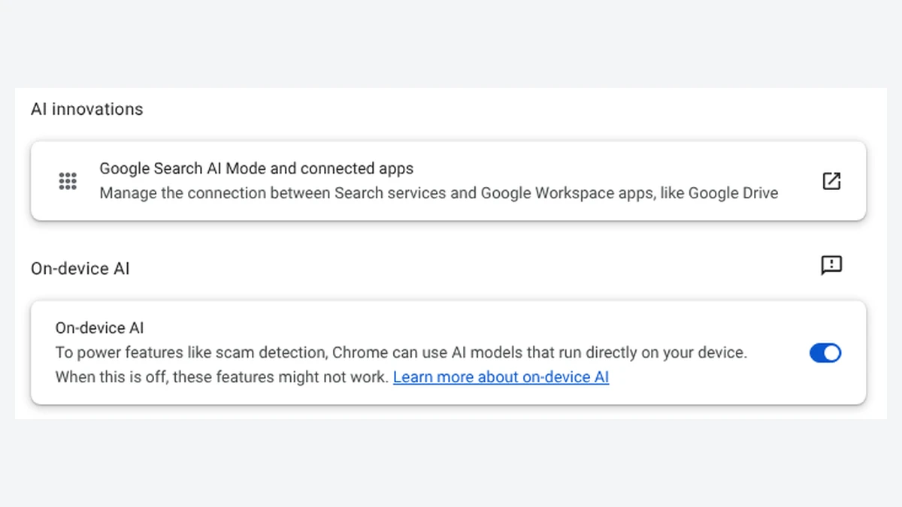

To turn off Gemini in Gmail, open Gmail on a computer, go to **Settings > See all settings > General**, click **Manage Workspace smart feature settings**, turn off **Smart features in Google Workspace**, and click **Save**. That one switch removes the Gemini side panel, "Help me write," email summaries, and AI answers in Gmail search, and the change follows your account to the Gmail app on your phone.

The catch is what goes with it. Google ties Gemini to a group of "smart features," so the same switch also stops Gmail from adding flight and hotel emails to Google Calendar. A second checkbox, which many guides tell you to clear too, has nothing to do with Gemini and turns off the Primary, Social, and Promotions inbox tabs. We read eight of Google's Gmail and Gemini help pages on October 22, 2026, and matched each Gemini feature to the setting that controls it, so you can turn off only what you want. We couldn't sign in to Gmail from our test computer, so the menu names below come from Google's help pages, not our own screen.

## Which Gemini features are in your Gmail?

Even a free Gmail account has some Gemini features: according to Google's [list of Gemini features in Gmail](https://support.google.com/mail/answer/16831098), personal accounts get AI Overview summaries at the top of long email threads everywhere, plus "Help me write" and Suggested Replies in the US. The rest need a paid Google AI plan (Google AI Plus, Pro, or Ultra) or a work or school Workspace plan.

| Gemini feature | Free personal account | Google AI or Workspace plan | Can you turn off only this? |
| --- | --- | --- | --- |
| AI Overview email summaries | Yes | Yes | No, only with the Workspace switch |
| Help me write | US only | Yes | No, only with the Workspace switch |
| Suggested Replies | US, English only | Yes | No, only with the Workspace switch |
| AI Overview in Gmail search | No | Yes, English only | No, only with the Workspace switch |
| AI Inbox | No | US, English only | Yes, **Show AI Inbox** checkbox |
| Proofread | No | Yes, on the web | Yes, **Grammar suggestions off** |
| Gemini side panel (**Ask Gemini**) | No | Yes | No, only with the Workspace switch |

With a paid plan, the side panel's **More options** menu also lists your Gems, which Google is replacing with skills, as our [guide to the Gems to skills change](/posts/gemini-gems-to-skills) explains.

If you live in the European Economic Area, the UK, Switzerland, or Japan, Google says these smart feature settings start out off, so you may not see any of this unless you turned them on.

## How to turn off Gemini in Gmail on a computer

On a computer, you turn off Gemini in Gmail by switching off **Smart features in Google Workspace** in Gmail's settings. These steps come from Google's [smart features help page](https://support.google.com/mail/answer/15604322):

1. Open Gmail in a web browser.
2. At the top right, click **Settings** (the gear icon), then **See all settings**.
3. On the **General** tab, scroll to **Google Workspace smart features**.
4. Click **Manage Workspace smart feature settings**.
5. Turn off **Smart features in Google Workspace**.
6. At the bottom right, click **Save**.

The same window has a second switch, **Smart features in other Google products**. Leave it on if you only want Gemini out of Gmail; turn it off too if you don't want the Gemini app or Google Search to use your email (see [Stop the Gemini app from reading your Gmail](#how-to-stop-the-gemini-app-from-reading-your-gmail)).

## How to turn off Gemini in the Gmail app on Android

On Android, the Gemini switch is under **Google Workspace smart features** in the Gmail app's settings for each account:

1. Open the Gmail app.
2. At the top left, tap **Menu**, then **Settings**.
3. Tap the account you want to change.
4. Under **General**, tap **Google Workspace smart features**.
5. Uncheck **Smart features in Google Workspace**.

## How to turn off Gemini in the Gmail app on iPhone or iPad

On an iPhone or iPad, the Gemini switch is under **Data privacy** in the Gmail app's settings:

1. Open the Gmail app.
2. At the top left, tap **Menu**, then **Settings**.
3. Under **General**, tap **Data privacy**.
4. Tap **Google Workspace smart features**.
5. Turn off **Smart features in Google Workspace**, then tap **Done** at the top right.

Google says a change applies to every device where you're signed in, but also that "some changes made on your computer don't reflect in the mobile app." If Gemini features still show up on your phone after you changed the setting on a computer, update the Gmail app and repeat the steps on the phone.

## What else turns off with Gemini?

Turning off **Smart features in Google Workspace** removes every Gemini feature in Gmail and also stops Gmail events, such as flight itineraries and invitations, from appearing in Google Calendar. Google's help page lists these as the experiences you lose with that switch: showing Gmail events in Calendar, personalized search with file and keyword suggestions in apps like Drive, Gemini summaries, drafts and answers, and personalized feature suggestions.

The other two switches work separately, and you don't need to touch them to remove Gemini:

| Switch | Where it is | What you lose when it's off |
| --- | --- | --- |
| **Smart features in Google Workspace** | Manage Workspace smart feature settings | All Gemini features in Gmail, Gmail events in Calendar, personalized search in Drive |
| **Smart features in Gmail, Chat, and Meet** | **General** tab checkbox next to **Smart features** | Primary, Social, and Promotions tabs, Smart Compose, Smart Reply, summary cards for trips and package tracking |
| **Smart features in other Google products** | Manage Workspace smart feature settings | Personal Intelligence in the Gemini app and Search, restaurant reservations in Maps, ticket and pass suggestions in Wallet |

Some guides warn that turning off Gemini also turns off spell check. Google's own lists for these switches don't mention spelling; the closest is its note that turning off email summaries "also disables other tools, such as AI-assisted writing and proofreading." Gmail's spelling and grammar options are on the same **General** tab, so you can check them after you save.

## How to turn off one Gemini feature and keep the rest

Only two Gemini features in Gmail have their own off switch: AI Inbox and Proofread. Everything else, including email summaries and "Help me write," goes on or off with the Workspace switch.

- **AI Inbox**: go to **Settings > See all settings > Inbox** and uncheck **Show AI Inbox**. According to [Google's AI Inbox page](https://support.google.com/mail/answer/16845247), this is a beta for paid plans in the US and in English.
- **Proofread**: go to **Settings > See all settings > General** and, next to **Grammar**, choose **Grammar suggestions off**. Google's [Proofread page](https://support.google.com/mail/answer/16887555) warns that you won't get grammar suggestions either.
- **Email summaries**: you can't turn them off alone, but you can click **Minimize** on the summary card at the top of a thread to hide it.
- **AI Overview in Gmail search**: it only appears when you type a question in plain words. Google's [search page](https://support.google.com/mail/answer/16789526) says it doesn't appear when you use search operators such as "from:" or "is:unread".

## How to stop the Gemini app from reading your Gmail

The Gemini app at gemini.google.com can search and summarize your Gmail through a connection that is separate from Gmail's own settings. To remove it, follow Google's [Connected Apps steps](https://support.google.com/gemini/answer/13695044):

1. Go to gemini.google.com on a computer.
2. In the sidebar, click **Customize** (click **More** first if you don't see it).
3. At the top, click **Connectors**.
4. Next to Gmail, click **More options**, then **Disconnect**.

The same Connectors tab lists every other app Gemini can reach, and our look at [Gemini's new Customize menu for Connected Apps](/posts/gemini-connected-apps) explains what disconnecting one does and doesn't delete.

To also stop Personal Intelligence in the Gemini app and in Google Search from using your email, turn off **Smart features in other Google products** in Gmail's **Manage Workspace smart feature settings**. Our guide to [Gemini Personal Intelligence on Android Auto](/posts/gemini-android-auto-personal-intelligence) covers the same setting from the car side. Since October 16, 2026, Google's privacy policy also lets email data you connect to Search shape ads; our article on [Google Personal Intelligence using Gmail and Photos for ads](/posts/google-gmail-photos-ads) lists the switches that stop it.

## Why "Help me write" can still appear after you turn off Gemini

If a "Help me write" box still pops up in Gmail after you turn off the Workspace switch, it's probably Chrome's own writing tool, not Gmail's. Chrome has a separate "Help me write" feature that works in text boxes on any website, and Gmail's settings don't control it.

We checked Chrome's settings ourselves. In Google Chrome 156 (version 156.0.8078.47, the stable release we ran on October 22, 2026), **Settings > AI innovations** in a fresh profile that wasn't signed in showed only two items: **Google Search AI Mode and connected apps** and the **On-device AI** switch. Chrome's "Help me write" settings appear there only after you sign in to Chrome. Our guide to [turning off AI in Chrome](/posts/turn-off-ai-in-chrome) shows where to switch it off (**Settings > AI innovations > Help me write > Offer writing help**; on some computers the **AI innovations** item is named **AI in Chrome**).

## Can you turn off Gemini in a work or school Gmail account?

Yes, you can usually turn off Gemini in a work or school Gmail account with the same steps. Google's [admin guide for smart features](https://support.google.com/a/answer/10095404) says administrators can choose a default for their users, "but users can override the default in their individual settings." Outside the European Economic Area, the UK, Switzerland, and Japan, Google turns these settings on by default for organizations. On some business and school editions, administrators can also turn Gemini on or off for each app, including Gmail, according to Google's [Gemini access guide for admins](https://support.google.com/a/answer/15698295), and Gemini is on by default. If a Gemini button stays after you change the setting, ask your IT team.

## Does this turn off Gemini in Google Docs?

Yes. The **Smart features in Google Workspace** switch covers Gemini features "across Workspace," which includes Docs, Sheets, Slides, and Drive, so you don't need a separate setting in each app. On a personal account, the Gemini side panel in Docs only appears with a Google AI plan or in Google's test program, according to the [Gemini in Docs help page](https://support.google.com/docs/answer/14206696). You can also reach the same switch from Drive at **Settings > Settings > Privacy > Manage Workspace smart feature settings**. Microsoft Word works the other way around: its Copilot switch is separate in every app and on every computer, as our guide to [turning off Copilot in Word](/posts/turn-off-copilot-in-word) explains. Our [guide to turning off AI in Chrome, Gmail, Word and more](/posts/turn-off-ai-features) lines up the AI switches in Chrome, Windows 11 and iPhone as well.

## How we checked

- **Google help pages** (opened October 22, 2026): Gmail [smart features](https://support.google.com/mail/answer/15604322) for computer, Android, and iPhone; [Gemini features in Gmail](https://support.google.com/mail/answer/16831098); [AI Overview conversation summaries](https://support.google.com/mail/answer/16561387); [AI Overview in Gmail search](https://support.google.com/mail/answer/16789526); [AI Inbox](https://support.google.com/mail/answer/16845247); [Proofread](https://support.google.com/mail/answer/16887555); [Suggested Replies](https://support.google.com/mail/answer/15464729); ["Help me write"](https://support.google.com/mail/answer/13955415); Gemini [Connected Apps](https://support.google.com/gemini/answer/13695044); and the Workspace [admin guide](https://support.google.com/a/answer/10095404).
- **Chrome**: we ran Google Chrome 156.0.8078.47 for Linux with a new profile and opened **Settings > AI innovations** to see which AI settings appear without signing in.
- **What we couldn't test**: we had no Google account on our test computer, so we didn't see Gmail's settings screens or check whether Gemini icons disappear right away after you save.

## Which switch should you turn off?

- **You want Gemini gone but your inbox tabs and Smart Compose to stay**: turn off only **Smart features in Google Workspace**.
- **You also don't want Google's other apps to use your email**: turn off **Smart features in other Google products** too, and disconnect Gmail in the Gemini app.
- **You only dislike one feature**: uncheck **Show AI Inbox** or set **Grammar suggestions off** for Proofread, and leave the rest.
- **You rely on flight and hotel emails showing up in Calendar**: keep the Workspace switch on, because that feature turns off with Gemini.

If you're deciding whether a paid plan is worth it for these Gmail features, our look at [the Gemini free plan's switch to Flash-Lite](/posts/gemini-free-flash-lite) compares what each Google AI plan includes.

## FAQ

### Does turning off smart features delete what Google already learned from my email?

No. Google says that once a smart feature setting is off, your Gmail content is no longer used to provide or improve those features, but "the learnings developed from this improvement process may persist" after you turn the setting off.

### Do I need to turn this off for each Gmail account?

Yes. The settings belong to each Google account, so repeat the steps for every account you use. On Android, the Gmail app asks you to pick the account before you change the setting.
