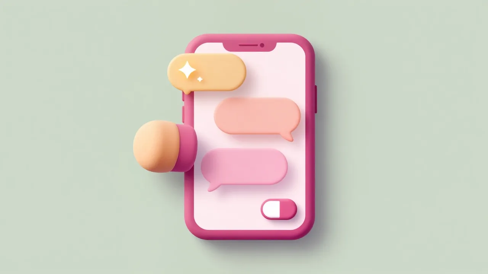
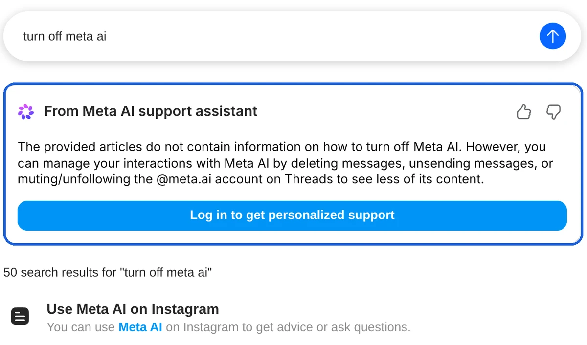

You can't turn off Meta AI on Instagram. As of October 2026, Instagram has no setting that removes or hides Meta AI, and when we searched Instagram's Help Center for "turn off meta ai" on October 24, 2026, Meta's own support assistant replied that its articles "do not contain information on how to turn off Meta AI." What you can do is make Meta AI forget your chats by sending **/reset-ai** in your Meta AI chat, then delete that chat, and switch off the few Meta AI features that have their own toggle: AI images of you, AI-dubbed Reels and Meta AI apps reusing your reel audio.

We went through more than 20 of Meta's own pages on October 24, 2026: the Instagram, Facebook and WhatsApp Help Centers, Meta's Privacy Center and two Meta Newsroom announcements. We didn't have an Instagram account to test with, so the steps below come from Instagram's iPhone help pages rather than our own screens. The table sums up what each control does.

| To do this | Where | What it changes |
| --- | --- | --- |
| Make Meta AI forget a chat | Send **/reset-ai** in the Meta AI chat | Deletes Meta AI's copy of that chat |
| Make every AI on Instagram forget you | Send **/reset-all-ais** in any AI chat | Resets all AI chats, group chats included |
| Remove the Meta AI chat from your inbox | **Messages**, tap and hold the chat, **Delete** | Your own inbox only |
| Stop AI images of you | Meta AI chat > **AI info > Imagine yourself** | Turns the feature off and deletes your setup photos |
| Watch reels without AI dubbing | **View translations** on a reel, or **Don't translate** | One reel, or all reels |
| Stop Meta AI apps from reusing your reel audio | **Profile > Menu > Sharing and reuse** | Your public reels |

## Can you turn off Meta AI on Instagram?

No, Instagram has no setting that turns Meta AI off or removes it from the app as of October 2026. When we searched Instagram's Help Center for "turn off meta ai," none of the 50 results explained how to switch it off, and the top ones explained how to use it. The Meta AI support assistant at the top of the results said the same thing in its own words.

Facebook's Help Center gave a matching answer to the same search: its support assistant said there "isn't a direct option to 'turn off' Meta AI entirely." These assistant answers are written by AI and can change from one search to the next, but they line up with what the help articles cover.

Instagram also says its AI features "are being gradually introduced and may not be available to you yet," so your app may show fewer of the Meta AI entry points listed below.

## Where Meta AI shows up on Instagram

Meta AI appears in five places on Instagram, and it reads and answers only what you or someone in your chat sends to it, according to [Instagram's guide to using Meta AI](https://help.instagram.com/2050445508681504/?cms_platform=iphone-app):

- **The search bar** in Explore and your inbox, with suggested questions for Meta AI below it and a **Meta AI** button next to it.
- **Compose** in Messages, where Meta AI is listed under **Suggested**.
- **Chats with other people**, where anyone can type "@" and pick Meta AI.
- **The message box**, with **Edit with Meta AI** next to a message you're writing and **Write with AI** when you highlight text ([Instagram Help](https://help.instagram.com/454257637526184/?cms_platform=iphone-app)).
- **Your inbox**, where some people can ask Meta AI to summarize unread chats.

None of these have a switch. You can ignore them, but you can't remove them.

## How to make Meta AI forget your chats

Sending **/reset-ai** in your Meta AI chat deletes Meta AI's copy of that conversation and the details it saved about you from it, according to Meta's Privacy Center page on [changing or deleting your information from chats with AIs](https://www.facebook.com/privacy/dialog/change-or-delete-ai-chat-info/).

1. Tap **Messages** and open your chat with Meta AI.
2. Type **/reset-ai** as a message and send it.
3. To reset every AI you've chatted with on Instagram at once, including Meta AI in group chats, send **/reset-all-ais** instead.

You'll still see your copy of the conversation afterward, but Meta AI won't remember the earlier messages. The same two commands work in Messenger and WhatsApp, and each one resets the AIs only in the app where you send it.

## How to delete the Meta AI chat from your inbox

Delete the Meta AI chat the way you delete any Instagram chat, but reset Meta AI first, because deleting only removes the chat from your own inbox. Meta's Privacy Center says to use the reset commands and then "clear this chat from your view using the delete chat steps in that app."

1. Tap **Messages** at the bottom of the screen.
2. Tap and hold your conversation with Meta AI.
3. Tap **Delete**, then tap **Delete** again to confirm.

[Instagram's delete steps](https://help.instagram.com/1467256816910908/?cms_platform=iphone-app) note that deleting a conversation only deletes it for you. Instagram also says that if you permanently delete the Meta AI chat and start a new one, your previous messages will no longer be available.

Stopping a feature without deleting its history is common across AI products. Google works the same way when you disconnect an app from Gemini, as we found when we looked at [what disconnecting Gemini Connected Apps doesn't delete](/posts/gemini-connected-apps).

## How to keep your messages away from Meta AI in group chats

You can't stop other people in a chat from using Meta AI, and when they do, Instagram says messages from the past 30 days in that chat are shared with it. Instagram's page [about sharing with Meta AI](https://help.instagram.com/1325125818682650) puts it plainly: "people can share your messages and photos from chats with Meta AI." That covers asking @Meta AI a question, summarizing unread messages, rewriting a message and editing a photo in the chat.

Instagram's help pages don't describe any setting that blocks @Meta AI in a group. What Instagram suggests instead:

- **Keep sensitive details out of chats.** Instagram tells you to be mindful before sharing passwords, financial information or other sensitive details in chats you don't want AIs to use.
- **Unsend what you've already sent.** Instagram's advice is to delete or edit messages you don't want shared, but [deleting a message](https://help.instagram.com/890932425718081/?cms_platform=iphone-app) only removes it from your own view. To take back a message you sent, unsend it instead.
- **Muting doesn't help here.** Muting a group chat on Instagram only stops its notifications.

Meta says it takes "steps to try to remove certain personal identifiers" from messages others share with Meta AI before using them to improve its AI.

## How to turn off AI images of you

If you set up Imagine yourself, you can turn it off on the Meta AI chat's **AI info** screen, which also deletes the setup photos you took. According to [Instagram's Imagine yourself page](https://help.instagram.com/814837257408912/?cms_platform=iphone-app), the feature is still being introduced gradually in the United States.

1. Open your chat with Meta AI.
2. Tap **AI info**.
3. Tap **Imagine yourself**.
4. Turn off **Create AI images of yourself with Meta AI**.

To keep the feature but stop the images from appearing in your Feed, turn off **See AI images of yourself in Feed** on the same screen instead. Only you can see those Feed images unless you share them. If you turn the feature back on later, you'll need to retake your setup photos.

For images other people post, our guide to [checking whether an image is AI-generated](/posts/check-if-image-is-ai-generated) shows which labels to look for and how easily they're lost.

## How to stop AI translations on Reels

Reels that Meta AI has translated carry a "Translated with Meta AI" label, and you can switch any of them back to the original language. Only reels whose creators turned on Meta AI translation are dubbed, and Meta says translation is free for all public Instagram accounts in countries where Meta AI is available.

- **For one reel:** tap **View translations** on the reel, then select the original language ([Instagram Help](https://help.instagram.com/413913451428736/?cms_platform=iphone-app)).
- **For all reels:** Meta's [Reels translation announcement](https://about.fb.com/news/2025/10/discover-reels-around-world-meta-ai-translation/) says to open the reel's three-dot menu and choose **Don't translate** in the audio and language section.

As of Meta's July 14, 2026 update, Reels translation on Instagram covers English, Spanish, Portuguese, Hindi, Bengali, Tamil, Telugu, Marathi, Kannada, French, German, Italian, Japanese and Korean.

## How to stop Meta AI apps from reusing your reel audio

If your account is public, people using the Meta AI apps and website can make reels with your original audio unless you turn it off under **Sharing and reuse**, according to [Instagram's page on reel audio](https://help.instagram.com/329208821595430).

1. Tap **Profile** or your profile picture in the bottom right.
2. Tap **Menu** in the top right.
3. Under **How others can interact with you**, tap **Sharing and reuse**.
4. Under **Allow people to create with and reuse your original audio on Meta AI**, turn off **Reels**.

This switch only covers the Meta AI apps and website. People on Instagram can still record reels with your original audio, as with any public reel.

## Can you remove Meta AI from the Instagram search bar?

No, Instagram has no setting that removes Meta AI from the search bar in Explore or your inbox. The search bar shows suggested questions for Meta AI, and Instagram's help page says pressing the enter key on your keyboard "may also start a chat with Meta AI, depending on the nature of the question or request."

To search Instagram the usual way, type a name or keyword and tap an account, tag or other result in the list instead of the keyboard's search key, especially when your search reads like a question.

## Does Meta use your Meta AI chats for ads?

Yes, since December 16, 2025, Meta has used what you say to Meta AI, by voice or text, to personalize the posts, reels and ads you see, according to Meta's [October 1, 2025 announcement](https://about.fb.com/news/2025/10/improving-your-recommendations-apps-ai-meta/). Meta's example: chatting with Meta AI about hiking can lead to recommendations for hiking groups, friends' trail posts or ads for hiking boots.

The same announcement sets a few limits:

- Conversations about religious views, sexual orientation, political views, health, racial or ethnic origin, philosophical beliefs or trade union membership aren't used to show ads.
- Meta combines AI chats only across the accounts you've added to the same Accounts Center, which WhatsApp says is being renamed Meta Account. If your WhatsApp account isn't in it, your Meta AI chats on WhatsApp aren't used to personalize Instagram or Facebook.
- Meta says the change applies in "most regions."

The announcement doesn't mention a way to opt out. The controls it points to, Ads Preferences and feed controls, change which ads and posts you see, not whether your AI chats are used. Short of not chatting with Meta AI, there's no setting that keeps them out.

Training is a separate question. Meta's [generative AI privacy page](https://www.facebook.com/privacy/genai) says it doesn't use your private messages with friends and family to train its AI "unless you or someone in the chat chooses to share those messages with our AIs," which is exactly what happens when someone in your group uses @Meta AI. Google drew a similar line in October 2026 for Gmail and Photos data connected to Search, which we covered in our analysis of [Google using Gmail and Photos data for ads](/posts/google-gmail-photos-ads).

## Facebook, Messenger and WhatsApp

The **/reset-ai** and **/reset-all-ais** commands also work in Messenger and WhatsApp, and Facebook's Help Center gave the same "no direct option" answer as Instagram's. WhatsApp's [About Meta AI](https://faq.whatsapp.com/2257017191175152) page calls Meta AI "an optional service," and its page on [deleting chats with Meta AI](https://faq.whatsapp.com/688464770796037) says you need the commands to delete Meta AI's copy of your messages. The commands don't work in Incognito chats with Meta AI, because WhatsApp doesn't save those.

For AI in other apps, including Chrome, Gmail, Word, Windows 11 and iPhone, see our [guide to turning off AI in Chrome, Gmail, Word and more](/posts/turn-off-ai-features).

## How we checked

On October 24, 2026, we opened Meta's pages in a Chromium browser and saved their text: 16 Instagram Help Center pages (using Meta AI, sharing with Meta AI, writing and summarizing with Meta AI, Imagine yourself, deleting chats and messages, muting group chats, Reels translations, reel audio, requests to add you to AI images, custom AIs and parental supervision, plus the search for "turn off meta ai"), the Facebook Help Center search for the same words, two WhatsApp Help Center pages, two Meta Privacy Center pages, and Meta Newsroom posts from October 1 and October 9, 2025. For pages with separate instructions per device, we used the iPhone version, so menu names on Android may differ slightly.

We didn't have an Instagram account, so we couldn't confirm these menus on a phone or check whether your app has every feature. The support assistant answers we quote are AI-generated and may read differently when you search.

## Which settings should you change?

Start with the chats Meta AI already has, then turn off the extras you don't use:

- **If you've chatted with Meta AI and want it to forget:** send **/reset-all-ais** in your Meta AI chat, then delete the chat from your inbox.
- **If you set up AI images of yourself and changed your mind:** turn off **Create AI images of yourself with Meta AI** under **AI info > Imagine yourself**.
- **If you post public reels:** turn off audio reuse on Meta AI under **Sharing and reuse**.
- **If dubbed reels bother you:** choose **Don't translate** in a reel's three-dot menu.
- **If friends use Meta AI in your group chats:** keep passwords, money details and anything private out of those chats, and unsend messages you regret.
- **If you don't want Meta AI shaping your ads:** there's no switch, so the only option is not to chat with Meta AI. Ads Preferences can still adjust which ads you see.

If you use an iPhone, Apple's own AI features are separate from Meta's. Our guide to [turning off Apple Intelligence on iPhone](/posts/turn-off-apple-intelligence-iphone) covers those settings.

## FAQ

### Can you mute or block Meta AI on Instagram?

Instagram's Help Center doesn't document a mute or block option for Meta AI as of October 2026. Guides from 2024 describe muting the Meta AI chat, but Instagram's Meta AI menus have changed since then. The **AI info** screen in your Meta AI chat is where Instagram keeps Meta AI's own settings, so check there first. Keep in mind that muting a chat on Instagram only stops its notifications.

### Can parents turn off Meta AI for a teen on Instagram?

No, the supervision tools Instagram lists for parents don't include a Meta AI switch. According to [Instagram's supervision guide](https://help.instagram.com/658522825492278), a supervising parent can see the general topics their teen asked Meta AI about in the past 7 days, but not the exact questions or Meta AI's answers.
