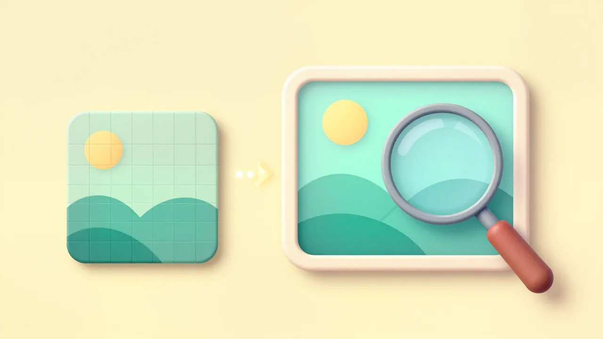
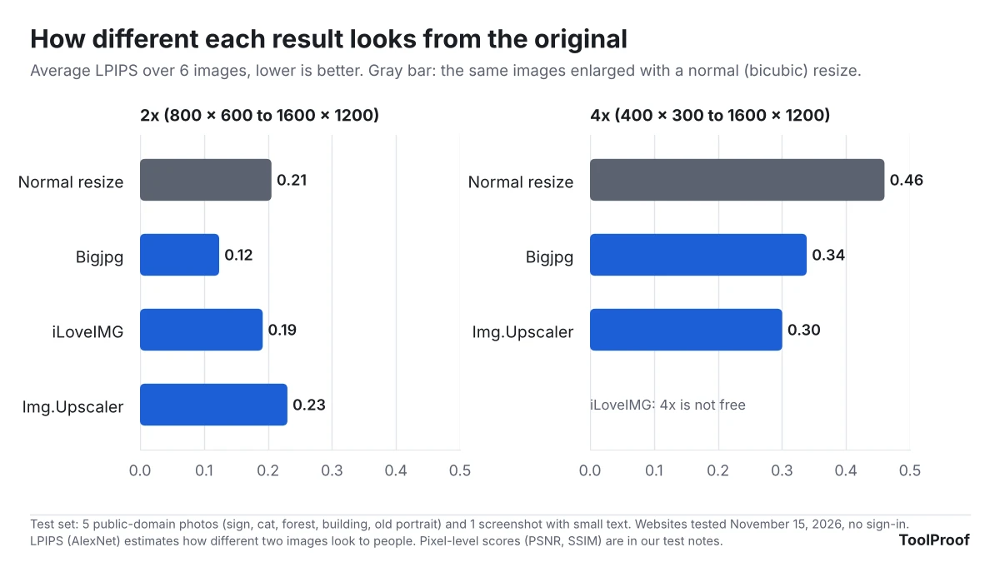
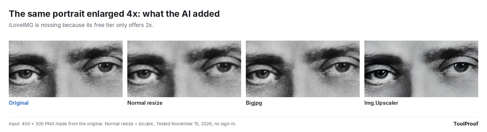
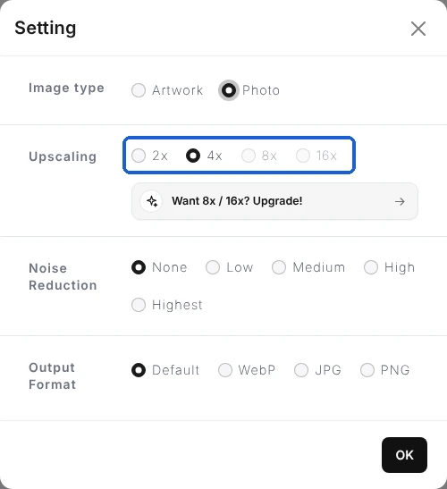
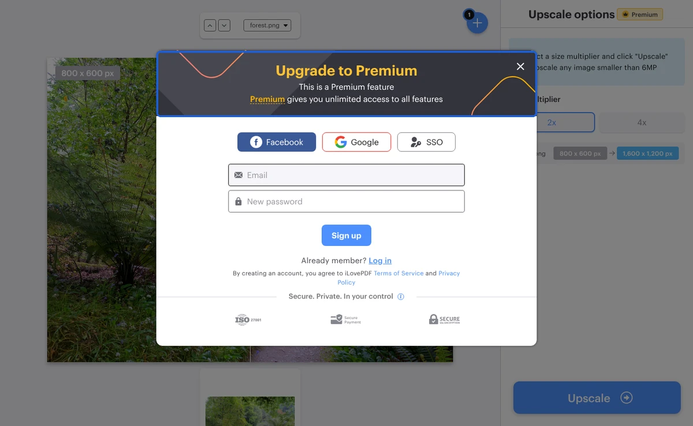
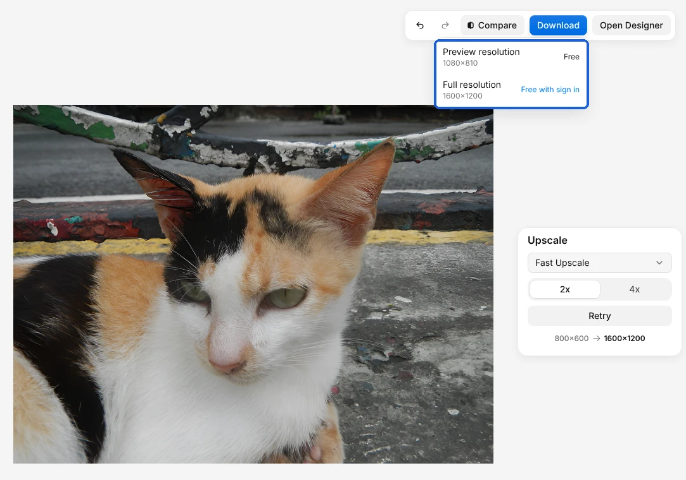

To upscale an image without losing quality, use a free AI upscaler instead of a normal resize, and stay at 2x when you can. No tool can bring back detail the camera never captured, but in our November 15, 2026 test the free Bigjpg website, set to Photo, enlarged all six of our test images at both 2x and 4x so they came out closer to the originals than a normal resize did, on every image and by both scores we used.

We tested this by shrinking five public-domain photos and one screenshot to half and quarter size, enlarging them back with three free upscaler websites that need no account, and comparing each result with the original. The other two were less reliable: iLoveIMG only enlarges 2x for free and was mixed, and Img.Upscaler made the sharpest-looking 4x images but changed letters in small text, turning a "12" in a date into what reads as "17". Two more sites that advertise free upscaling, Pixelcut and Icons8, gave us only a smaller preview or a watermarked image without signing in.

| Tool | Best for | Free sizes | Closer to the original than a normal resize | Free limits we found |
| --- | --- | --- | --- | --- |
| **Bigjpg** (website) | Most photos and screenshots | 2x, 4x | 6 of 6 images at 2x and at 4x | 3000 x 3000 px and 5 MB per image |
| **iLoveIMG** (website) | A quick 2x on one or two images | 2x only | 4 of 6 at 2x by look, 2 of 6 by pixels | Premium pop-up after a few images |
| **Img.Upscaler** (website) | Landscapes with no text or faces | 2x, 4x | 5 of 6 at 4x by look, 1 of 6 by pixels | 50 credits a month, JPEG output |

## Can you really upscale an image without losing quality?

You can't enlarge an image without some loss, because the extra pixels have to be made up, but an AI upscaler makes them up much more convincingly than a normal resize. A normal resize, the kind every photo editor does when you type a bigger width, spreads the existing pixels out and smooths the gaps, so edges and fine texture turn soft. An AI upscaler guesses what the missing detail probably looked like, based on what it learned from other photos, and draws it in.

That guess is the catch. On a photo of a cat or a building, a good guess looks like the real thing. On text, faces and numbers, a wrong guess can look sharp and still be wrong, which is exactly what we saw at 4x. Two habits help more than any tool:

- **Start from the biggest copy you have.** A copy that was already shrunk, for example to send in a chat, has less real detail for any tool to work with.
- **Ask for the smallest enlargement that does the job.** Both tools we ran at both sizes came out closer to the original at 2x than at 4x.

## How we tested

We needed originals to compare against, so we made our own low-resolution images. We took five public-domain photos from Wikimedia Commons (a street sign, a calico cat, a forest path, a white building and an old black-and-white portrait) plus one screenshot-style image of an order summary with small text, cut each to 1600 x 1200 pixels, and shrank it to 800 x 600 for the 2x test and 400 x 300 for the 4x test.

We then uploaded the small copies to each website in a Chromium browser on November 15, 2026, without signing in, kept the default settings (on Bigjpg we picked **Photo** and the size), and downloaded the results. Every scored result came back at exactly 1600 x 1200, so we could line it up with the original pixel for pixel and measure:

- **How different it looks**, with LPIPS, a score designed to match what people notice. Lower is better. This is the score we lead with.
- **How accurate the pixels are**, with PSNR in decibels. Higher is better. It punishes invented detail, even when it looks good.
- **A normal resize** of the same small copies (bicubic, a common kind of normal resize) as the baseline every tool had to beat.

A tool "beat a normal resize" on an image when its score was better than the normal resize of that same image. Websites can change their AI models at any time, so treat these results as a snapshot of November 2026.

## Results at 2x: only Bigjpg won on every image

In our November 15, 2026 test at 2x, Bigjpg was the only website that beat a normal resize on all six images by both scores, with an average LPIPS of 0.12 against 0.21 for the normal resize and 31.0 dB against 29.3 dB for pixel accuracy. That means about 40% less visible difference from the original than a normal resize.

iLoveIMG averaged 0.19, slightly better than a normal resize, but it won on only four of the six images by look and two of six by pixel accuracy. On the old portrait it darkened the shadows around the eyes and roughened the skin, which made that result look further from the original (0.34) than even a normal resize (0.14).

Img.Upscaler averaged 0.23, worse than a normal resize, and its pixels were less accurate than a normal resize on all six images. Part of that is the file: it gave us JPEG files, which throw away a little detail to save space, even though the downloads were named ".png". The other two sites returned true PNG files.

## Results at 4x: sharper is not the same as right

At 4x, Bigjpg again beat a normal resize on all six images by both scores (LPIPS 0.34 against 0.46, and 26.4 dB against 25.4 dB), while Img.Upscaler looked the sharpest but had the least accurate pixels of all, including the normal resize. iLoveIMG's 4x button is marked Premium, so it isn't part of this round.

Img.Upscaler's average LPIPS of 0.30 was the lowest at 4x, because its results have crisp edges and plenty of texture, which people (and LPIPS) tend to read as close to a real photo. But its pixel accuracy, 24.0 dB, was below the normal resize's 25.4 dB, and it beat the normal resize on pixels in only one of six images. Zooming in shows why: the crispness is partly invented.

On the smallest line of the screenshot, Img.Upscaler drew sharp, confident letters that are wrong: "Order" came out looking like "Oidor," "November" lost its e's, and the "12" in the date turned into something that reads as "17". Bigjpg's version is smudged in places, but the date still reads November 12, 2026. If you're enlarging a receipt, a screenshot or anything with numbers, check every figure against the original, or skip AI and use a normal resize.

The portrait shows the same thing. Img.Upscaler gave the man darker lashes, deeper lines under the eyes and more contrast than the original photo has, and it even added a faint blue-green tint to one iris of a black-and-white picture. It looks like a sharper photo, just not quite the same face. Bigjpg's version is softer and has some blotchy texture, but it keeps the face as it was.

## How to upscale an image with Bigjpg

Bigjpg enlarges a photo 2x or 4x for free with no account, and each of our images took under a minute from upload to download.

1. Go to [bigjpg.com](https://bigjpg.com/en) and click **Select Images**, then choose your photo.
2. Click **Start** next to the image.
3. In the **Setting** window, choose **Photo** under **Image type** (pick **Artwork** for drawings and cartoons).
4. Under **Upscaling**, choose **2x**, or **4x** if you need it. 8x and 16x need a paid upgrade.
5. Leave **Noise Reduction** at **None** for a clean photo. The window also offers Low to Highest; we tested only None.
6. Leave **Output Format** at **Default** (we got PNG files) and click **OK**.
7. When the image shows **Completed**, click **Download**.

According to [Bigjpg's FAQ](https://bigjpg.com/en/faq), free users can upload images up to 3000 x 3000 pixels and 5 MB, and images uploaded from free accounts are deleted within 24 hours. The PNG files we got were large: 0.3 MB for the screenshot and 1.6 to 4.1 MB for the 2x photos.

## How to upscale an image with iLoveIMG

iLoveIMG enlarges an image 2x for free, and it's quick, but its 4x option is Premium and it may stop you after a few images.

1. Go to [iLoveIMG's Upscale image page](https://www.iloveimg.com/upscale-image) and click **Select images**.
2. Under **Size multiplier**, leave **2x** selected.
3. Click **Upscale**, then **Download upscaled image**.

The page says it works on images smaller than 6 megapixels. In our test, after two or three images in a row, iLoveIMG sometimes showed an **Upgrade to Premium** window instead of starting, and the same image went through when we tried again later. iLoveIMG's [legal page](https://www.iloveimg.com/help/legal) says processed files are deleted from its servers within 2 hours. Premium starts at $5 a month billed yearly, according to its [pricing page](https://www.iloveimg.com/pricing).

## Img.Upscaler: when a sharper look matters more than accuracy

Img.Upscaler is worth trying for landscapes, textures and other photos where nobody will check the details, but not for text, faces or numbers. To use it, go to [imgupscaler.com](https://imgupscaler.com/), click **Choose images**, pick **200%** or **400%**, click **Upload and start**, then **Download**.

Its [pricing page](https://imgupscaler.com/pricing) lists 50 free credits a month, one image at a time, with ads, and one credit for each successful image. The site says uploaded images and results are deleted within 24 hours. Remember that the download is a JPEG even if it's named ".png", so don't use it as an "original" you plan to edit again and again.

## Free upscalers that weren't free in our test

Several sites that call their upscaler free put the full result behind a sign-in, a watermark or a check we couldn't pass, so we left them out of the scores.

- **Pixelcut**: The page promises "No login needed, no watermark on your download," and the upscale itself ran without an account. But when we clicked **Download**, only **Preview resolution 1080x810** was free; the full **1600x1200** result was labeled "Free with sign in." The preview is smaller than the 2x size we asked for.
- **Icons8 Smart Upscaler**: The result had a "Smart Upscaler" watermark across it, and the page then showed "2 demo upscales left."
- **waifu2x**: The page showed a Cloudflare "Verify you are human" check above the **Convert** button, and we don't get around those checks, so we didn't test it. It lists a 1500 x 1500 pixel limit for upscaling.
- **Upscale.media**: According to its [pricing page](https://www.upscale.media/pricing), you can upscale one image a day without signing up. We didn't test it.
- **Upscayl**: A free, open-source desktop app for Windows, Mac and Linux, according to [its website](https://upscayl.org/). We didn't test it this time, so we can't say how it compares.

## Can Windows or Mac upscale an image without an app?

Windows can on Copilot+ PCs, while the Mac's built-in Preview app only does a normal resize. According to [Microsoft](https://support.microsoft.com/en-us/windows/ai/ai-apps/super-resolution-in-photos), the **Super resolution** feature in the Photos app is exclusive to Copilot+ PCs: open the image, select **Edit**, choose **Super resolution** and pick 1x, 2x, 4x or 8x, and the AI runs on your PC instead of uploading the photo. We didn't have a Copilot+ PC to test it.

On a Mac, [Preview](https://support.apple.com/guide/preview/prvw2015/mac) can make an image bigger under **Tools > Adjust Size** with **Resample image** selected, but that is a normal resize, the same kind as the gray bars in our chart.

## Which one should you use?

- **For most photos and screenshots**, use Bigjpg at 2x with **Photo** selected. It was the only tool that never did worse than a normal resize in our test.
- **If you need 4x**, still use Bigjpg, then zoom in on faces and any text before you use the result.
- **For anything with numbers or small text**, such as a receipt or a document photo, compare every figure with the original, or use a normal resize. A blurry number is better than a confident wrong one.
- **If you only need one quick 2x**, iLoveIMG works without an account.
- **If the enlarged photo is now too big to upload**, shrink the file size afterward; our guide to [compressing an image to 100KB](/posts/compress-image-to-100kb) shows which pixel size works best for common limits.
- **If your photo came from an iPhone**, you may need to [convert the HEIC file to JPG](/posts/convert-heic-to-jpg-free) first. Img.Upscaler, for example, lists only JPG, PNG, WebP and AVIF.

For other photo jobs, from background removal to video trimming, see our [best free image converter and photo tools](/posts/free-image-converter-photo-tools), where we test free tools the same way.

## FAQ

### Is it safe to upload photos to an upscaler website?

All three sites we tested say they delete uploads automatically: iLoveIMG within 2 hours, and Img.Upscaler and Bigjpg (for free accounts) within 24 hours. Until then, the photo sits on someone else's server, so avoid uploading images of documents or IDs. Photos from a phone can also carry the place they were taken, which you can [remove before you share them](/posts/remove-metadata-from-photos).

### Does upscaling fix a blurry photo?

Not reliably. Our test started from sharp photos that we made smaller, which is the case upscalers are built for. A photo that's blurry because the camera moved or missed focus is a different problem, and we didn't test it. For a similar test of AI websites on another photo job, see our comparison of [free remove.bg alternatives](/posts/remove-bg-alternative-free).
