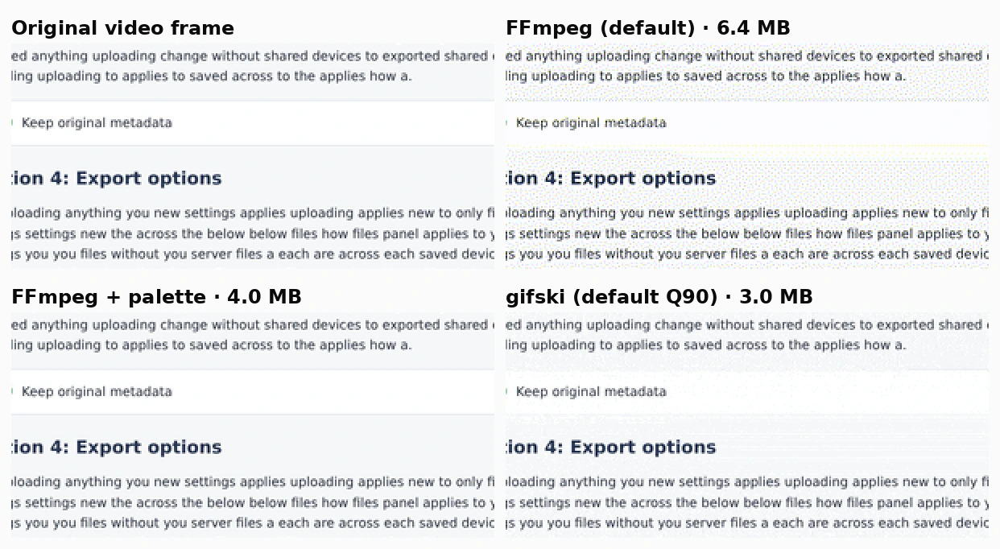
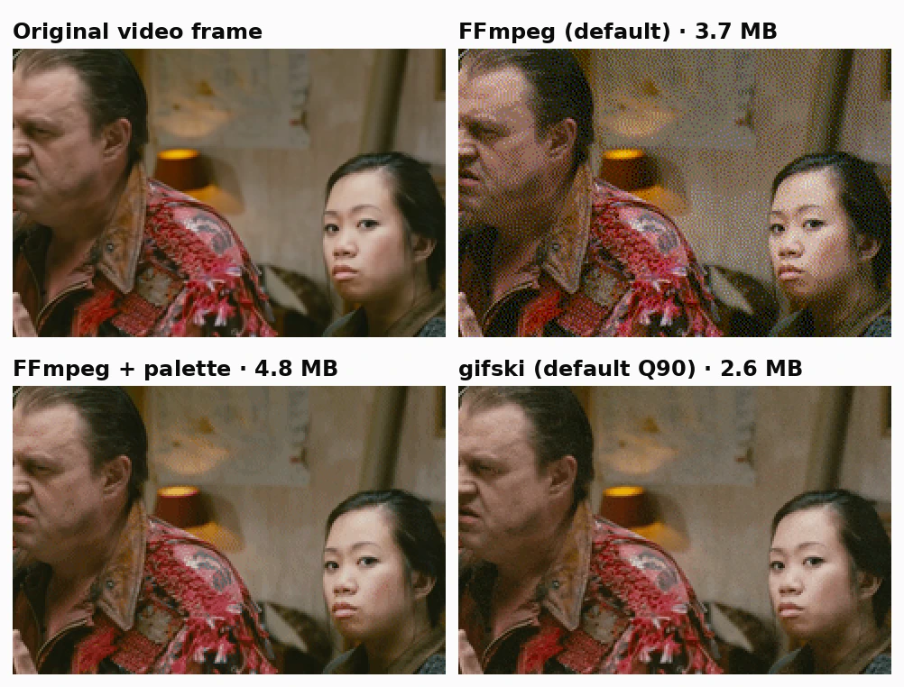
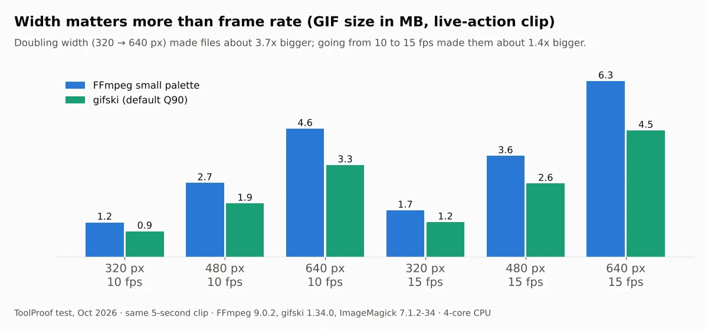

To turn a video into a high-quality GIF for free, use **gifski**. In our test it made the smallest GIFs that still looked clean: 6.5 MB for three clips, 38% smaller than FFmpeg with a custom palette and about half the size of ImageMagick. If you already have FFmpeg, add a palette step to the command. FFmpeg's plain `ffmpeg -i video.mp4 out.gif` command speckled every clip with dots, and those GIFs were also bigger.

We ran three free tools offline on October 16, 2026: FFmpeg 9.0.2, gifski 1.34.0 and ImageMagick 7.1.2-34, with seven settings in total. Each setting turned the same three 5-second clips into GIFs at 15 frames per second: a scene from an animated film with soft sky gradients, a live-action scene with faces, and a screen recording of a settings page with small text. For each GIF we measured the file size, how close every frame is to the original video frame, whether it plays at the right speed, and how long and how much memory it took. GIF allows at most 256 colors in a color table ([GIF89a specification](https://www.w3.org/Graphics/GIF/spec-gif89a.txt)), so the difference between tools comes down to how they pick those colors and hide the steps between them.

![Three bar charts of GIF size with a quality score for each of 7 settings. Animation: FFmpeg default 3.8 MB and 0.35 in red, FFmpeg with palette 1.7 MB and 0.95, FFmpeg small palette 1.2 MB and 0.96, gifski 0.9 MB and 0.94, gifski Q70 0.5 MB and 0.89, ImageMagick default 3.5 MB and 0.96, ImageMagick Optimize 1.4 MB and 0.94. Live action: FFmpeg default 3.7 MB and 0.57 in red, gifski 2.6 MB and 0.93, ImageMagick 5.2 MB. Screen recording: FFmpeg default 6.4 MB and 0.52 in red, FFmpeg with palette 4.0 MB and 1.00, gifski 3.0 MB and 0.98](./images/video-to-gif-high-quality-free/video-to-gif-size-quality-chart.webp)

## Free video to GIF converters at a glance

| Tool and setting | Best for | All 3 GIFs | Avg. SSIM | Time for 3 GIFs | Catch |
| --- | --- | --- | --- | --- | --- |
| **gifski (default)** | Most videos, smallest clean GIF | **6.5 MB** | 0.948 | 7.2 s | Faint grain in flat areas |
| **FFmpeg + palette** | Screen recordings, sharp text | 10.5 MB | 0.962 | 5.8 s | Bigger files than gifski |
| **FFmpeg small palette** | Fast and fairly small | 8.9 MB | 0.970 | 2.0 s | Visible bands in soft gradients |
| **ImageMagick** | When it's already installed | 12.5 MB | 0.972 | 41.2 s | Slow, 744 MB RAM, played 10% too fast |
| FFmpeg (default) | Nothing | 13.8 MB | 0.482 | 0.8 s | Dotted, off colors |

SSIM compares each GIF frame with the original video frame; 1.000 means identical. Every number is for the same 75 frames per clip. All three tools are free and open source, run on Windows, Mac and Linux, and never upload your video.

## How we tested

We cut three 5-second clips and scaled them with the same settings before any tool touched them, so every tool started from identical frames:

- **Animation:** a sky-and-meadow scene from [Big Buck Bunny](https://peach.blender.org/about/) ((c) copyright 2008, Blender Foundation / www.bigbuckbunny.org, CC BY 3.0), 480 pixels wide
- **Live action:** an indoor scene with two faces and a warm lamp from [Tears of Steel](https://mango.blender.org/sharing/) ((CC) Blender Foundation, mango.blender.org, CC BY 3.0), 480 pixels wide
- **Screen recording:** a scrolling settings page with 16-pixel text that we built and recorded ourselves, 640 pixels wide

Each clip became 75 PNG frames at 15 frames per second, and each tool turned those frames into a GIF. We judged the results on four things:

- **Size:** the GIF file size
- **Quality:** SSIM between each GIF frame and the matching original frame, plus a 2x zoom of the same area so you can see what the score misses
- **Playback speed:** the total of the frame delays stored in the GIF, which should be 5.0 seconds
- **Speed and memory:** median time of three runs and the peak memory, on a 4-core 2.8 GHz Intel Xeon with 16 GB of RAM and no GPU

We also ran the FFmpeg and gifski commands below directly on the source video file to check they give the same kind of result as our frame-by-frame test.

## Which video to GIF tool should you use?

### gifski: best for most videos

gifski made the smallest GIF of every clip at the default quality: 0.9 MB for the animation, 2.6 MB for the live-action scene and 3.0 MB for the screen recording. Its SSIM was slightly lower than FFmpeg's palette commands (0.948 against 0.962 on average), because it scatters fine grain across smooth areas instead of drawing hard color steps. Zoomed in, that grain made the sky gradient look closer to the original than FFmpeg's small palette or ImageMagick, which both left visible bands.


According to its [official site](https://gif.ski/), "Gifski uses pngquant for the best palettes with temporal dithering" and "can achieve thousands of colors per frame". The site offers free apps for Windows and Mac plus command-line versions; we tested the command-line version 1.34.0. Its code is licensed under AGPL-3.0 or later, according to its [crates.io listing](https://crates.io/crates/gifski).

gifski reads PNG frames or a `.y4m` video stream, so on the command line you pipe the video through FFmpeg:

```bash
ffmpeg -i video.mp4 -vf "fps=15,scale=480:-1:flags=lanczos" -f yuv4mpegpipe - | gifski --fps 15 -o out.gif -
```

Lowering quality with `--quality 70` cut the three GIFs from 6.5 MB to 4.1 MB, but the SSIM dropped to 0.897 and noise became visible on faces and the page background. If you need a smaller file, reduce the width first (see below).

### FFmpeg with a palette: best for screen recordings

Adding FFmpeg's palette filters gave the most accurate screen recording of any setting: SSIM 0.9995, and at 2x zoom we couldn't tell its text apart from the original. FFmpeg's [filter documentation](https://ffmpeg.org/ffmpeg-filters.html) describes `palettegen` as generating "one palette for a whole video stream" and `paletteuse` as using it to "downsample an input video stream". This one command does both:

```bash
ffmpeg -i video.mp4 -vf "fps=15,scale=480:-1:flags=lanczos,split[a][b];[a]palettegen[p];[b][p]paletteuse" out.gif
```

The catch is size. On the live-action clip this GIF was 4.8 MB, almost twice gifski's 2.6 MB.



A second set of options made FFmpeg's GIFs smaller and faster without lowering the average score: `palettegen=stats_mode=diff` builds the palette from the parts that move, and `paletteuse=dither=bayer:bayer_scale=5:diff_mode=rectangle` uses a fixed dot pattern and only redraws the changing area. That brought the three GIFs to 8.9 MB in 2.0 seconds, but it left the blotchy bands in the sky shown above. FFmpeg's docs say a higher `bayer_scale` means "less visible pattern at the cost of more banding", which is exactly what we saw.

### FFmpeg's default command: avoid it

Running `ffmpeg -i video.mp4 out.gif` without a palette gave the worst result on every clip: SSIM between 0.35 and 0.57, and grainy dots over skin, sky and text. FFmpeg's log showed why: it converted every frame to `bgr8`, a fixed set of 256 colors that doesn't adapt to the video. The dots also made the files bigger, 13.8 MB for the three clips against 10.5 MB with a palette.



### ImageMagick: works, but slow and the timing is off

ImageMagick scored the highest average SSIM (0.972) and kept the text sharp, but it made the biggest GIFs of any adaptive setting (12.5 MB), took 41 seconds for the three clips, and used up to 744 MB of memory on the screen recording. Adding `-layers Optimize` shrank the files to 9.6 MB but took 59 seconds.

The bigger surprise was speed. With `-delay 1x15` (15 frames per second), ImageMagick stored a 60-millisecond delay on every frame, so our 5-second clips played in 4.5 seconds, about 10% too fast. GIF stores delays in hundredths of a second, and 1/15 of a second isn't a whole number of them. FFmpeg and gifski alternated 70 and 60 milliseconds to keep the total at exactly 5.0 seconds. If you use ImageMagick, pick a frame rate that divides evenly into 100, such as 10, 20 or 25: with `-delay 10` (10 fps), our test GIF played in exactly 5.0 seconds.

Create a `frames` folder first, then:

```bash
ffmpeg -i video.mp4 -vf "fps=10,scale=480:-1:flags=lanczos" frames/%03d.png
magick -delay 10 frames/*.png -layers Optimize out.gif
```

## How to make a GIF smaller

Make it narrower before you lower quality. On the same 5-second live-action clip, doubling the width from 320 to 640 pixels made the GIF about 3.7 times bigger with both FFmpeg and gifski, while going from 10 to 15 frames per second made it about 1.4 times bigger.



What each change did in our test:

1. **Reduce the width.** Change `scale=480` to `scale=320` in the commands above. Going from 480 to 320 pixels cut the live-action GIF by about 53% with both tools.
2. **Lower the frame rate.** Change `fps=15` to `fps=10` (and `--fps 10` for gifski). That cut it by about 27%.
3. **Lower gifski's quality.** `--quality 70` cut our three GIFs by 37% but added visible noise.

Trimming the clip helps too, since a GIF stores every frame.

Live action costs the most bytes. At the same width and frame rate, the live-action GIF from gifski was almost three times the size of the animation GIF, likely because film grain and camera noise change on every frame while flat cartoon colors don't.

## How to convert video to GIF on Windows, Mac and Linux

### Windows

- **gifski:** download the free Windows app from [gif.ski](https://gif.ski/). We didn't test the app itself, only the command-line version.
- **FFmpeg:** FFmpeg's [download page](https://ffmpeg.org/download.html) links to Windows builds from gyan.dev, and [gyan.dev](https://www.gyan.dev/ffmpeg/builds/) lists `winget install ffmpeg` to install the full build. Then run the palette command above in PowerShell or Command Prompt.

### Mac

- **gifski:** get the free Mac app from the App Store link on [gif.ski](https://gif.ski/), or install the command-line version with `brew install gifski`.
- **FFmpeg:** `brew install ffmpeg`. Homebrew's [ffmpeg formula](https://formulae.brew.sh/formula/ffmpeg) is version 9.0.2 and its [gifski formula](https://formulae.brew.sh/formula/gifski) is 1.34.0, the same versions we tested.

### Linux

`sudo apt install ffmpeg` on Ubuntu or Debian works with the palette command above. Ubuntu 24.04 ships an older FFmpeg (6.1.1), which has the same `palettegen` and `paletteuse` filters. For gifski, use the Linux binary from the [gifski releases](https://github.com/ImageOptim/gifski/releases) or `cargo install gifski`.

## Full results

| Setting | Animation | Live action | Screen recording | Avg. SSIM | Lowest frame SSIM | Plays for | Time (3 GIFs) | Peak RAM |
| --- | --- | --- | --- | --- | --- | --- | --- | --- |
| FFmpeg default | 3.8 MB | 3.7 MB | 6.4 MB | 0.482 | 0.345 | 5.0 s | 0.8 s | 44 MB |
| FFmpeg + palette | 1.7 MB | 4.8 MB | 4.0 MB | 0.962 | 0.934 | 5.0 s | 5.8 s | 120 MB |
| FFmpeg small palette | 1.2 MB | 3.6 MB | 4.1 MB | 0.970 | 0.951 | 5.0 s | 2.0 s | 121 MB |
| **gifski (default Q90)** | **0.9 MB** | **2.6 MB** | **3.0 MB** | 0.948 | 0.925 | 5.0 s | 7.2 s | 57 MB |
| gifski Q70 | 0.5 MB | 1.5 MB | 2.1 MB | 0.897 | 0.863 | 5.0 s | 5.6 s | 57 MB |
| ImageMagick default | 3.5 MB | 5.2 MB | 3.8 MB | 0.972 | 0.956 | **4.5 s** | 41.2 s | 744 MB |
| ImageMagick Optimize | 1.4 MB | 5.0 MB | 3.3 MB | 0.958 | 0.937 | **4.5 s** | 59.2 s | 451 MB |

"Avg. SSIM" is the mean of the three clips' scores; "Lowest frame SSIM" is the least similar single frame across all three. Time is the median of three runs per clip, added up for the three clips.


SSIM measures how well shapes and edges match, so it doesn't punish color banding much and does punish grain. That's why gifski scores a little lower than FFmpeg's small palette yet looked smoother in the sky crop. Check a zoomed frame yourself if gradients matter in your video.

## Other tools we looked at

- **Online converters such as Ezgif, Canva and Adobe Express:** they work in a browser, but your video is uploaded to their servers. We only tested tools that run on your own computer.
- **Video editors such as Premiere Pro and CapCut:** many people search for GIF export in them, but we couldn't run them in our Linux test lab, so we didn't measure them.

## Which one should you use?

- **You want the best-looking GIF at a small size:** gifski with its default quality.
- **Your clip is a screen recording or has small text:** FFmpeg with the palette command; it was the closest to the original in our test.
- **You need it fast and slightly smaller, and your video has no soft gradients:** FFmpeg with `stats_mode=diff` and `dither=bayer:bayer_scale=5`.
- **You only have ImageMagick:** use 10 or 20 frames per second so the GIF plays at the right speed.

Whatever you use, don't run FFmpeg without a palette. If you're converting other files without uploading them, we ran the same kind of test for [compressing PDFs offline](/posts/compress-pdf-offline-free), [converting HEIC photos to JPG](/posts/convert-heic-to-jpg-free) and [removing image backgrounds offline](/posts/remove-background-from-image-free-offline). For more tools that work without an internet connection, see our [guide to free offline AI tools](/posts/free-offline-ai-tools).
