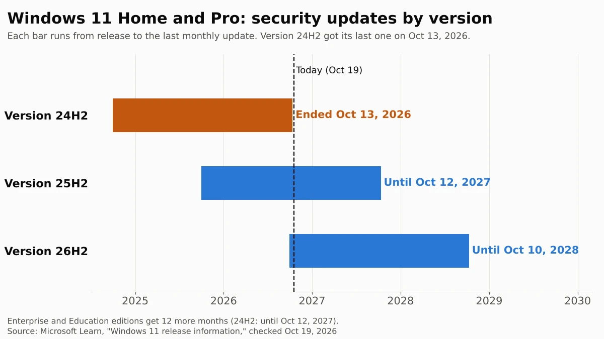

Windows 11 version 24H2 Home and Pro stopped getting security updates on October 13, 2026. The October 2026 security update was the last one, so a PC that stays on 24H2 will miss its first monthly fix on November 10, 2026, and every fix after that. Your PC keeps working, but new security holes will stay open.

The fix is free and smaller than it sounds. Microsoft offers version 26H2 to 24H2 PCs as a small "enablement package" that installs with a single restart, and it brings security updates until October 10, 2028. As of October 21, 2026, Microsoft says the 26H2 rollout has reached full availability for 24H2 PCs. Check your version in **Settings > System > About**, then look for the 26H2 offer in Windows Update.

We read Microsoft's release information, release health status pages, the 26H2 update article and its lifecycle FAQ on October 19, 2026, and checked them again on October 28, 2026.

## What happened

Microsoft's [Windows message center](https://learn.microsoft.com/en-us/windows/release-health/windows-message-center) announced on October 13, 2026 that Windows 11, version 24H2 Home and Pro editions "have reached end of updates" and that the October 2026 monthly security update is "the last update available for these editions." Devices on those editions no longer receive monthly security updates or optional preview updates.

Microsoft recommends moving to version 26H2 or 25H2. Version 26H2, also called the Windows 11 2026 Update, became available on September 29, 2026, according to Microsoft's [announcement](https://blogs.windows.com/windowsexperience/2026/09/29/how-to-get-windows-11-2026-update/). Microsoft first rolled it out in phases. On October 21, 2026, its status pages for [24H2](https://learn.microsoft.com/en-us/windows/release-health/status-windows-11-24h2) and 26H2 changed to say the rollout "has reached full availability for devices running Windows 11, versions 25H2 and 24H2." The same version 24H2 in Enterprise and Education editions stays supported until October 12, 2027.

## Who is affected

The dates below come from Microsoft's [Windows 11 release information](https://learn.microsoft.com/en-us/windows/release-health/windows11-release-information) page as of October 28, 2026, unchanged since October 19. Microsoft groups Pro Education and Pro for Workstations with Home and Pro.

| If your PC runs... | Security updates until | What to do |
| --- | --- | --- |
| Windows 11 Home or Pro, version 24H2 | Ended October 13, 2026 | Update to 26H2 (below) |
| Windows 11 Enterprise or Education, version 24H2 (work or school PCs) | October 12, 2027 | Nothing yet; your IT team decides |
| Windows 11 Home or Pro, version 25H2 | October 12, 2027 | Nothing urgent; 26H2 adds a year |
| Windows 11 Home or Pro, version 26H2 | October 10, 2028 | Nothing |
| Windows 11 version 26H1 (some new 2026 PCs) | March 14, 2028 | Nothing |
| Windows 11 version 23H2 Home or Pro | Already ended | Update to 26H2 |
| Windows 10 | Only through the paid or free ESU program | See our guide to [the Windows 10 security update extension](/posts/windows-10-esu-extended) |

## What changes for you

Nothing visible changes today. Microsoft's [lifecycle FAQ](https://learn.microsoft.com/en-us/lifecycle/faq/windows) says an unsupported version "may still work with programs and hardware," but it no longer gets "software updates, or security fixes." A 24H2 PC that installed the October 13 update is fully patched right now. The gap opens on November 10, 2026, when Microsoft releases the next monthly update for supported versions, and it grows every second Tuesday after that.

The update itself is less disruptive than past Windows upgrades. Microsoft's support article for the update, [KB5121794](https://support.microsoft.com/en-us/servicing/os/windows-11/2026/09/kb5121794-feature-update-to-windows-11-version-26h2), says versions 24H2, 25H2 and 26H2 "share a common core operating system with an identical set of system files." The 26H2 features are already on your PC, switched off, inside the monthly updates you installed. The enablement package is a small "master switch" that turns them on and needs one restart. The only requirement is the September 22, 2026 update or any later one, which a PC with the October update already has.

Microsoft's [release information](https://learn.microsoft.com/en-us/windows/release-health/windows11-release-information) page shows this in the update numbers: the October 13 update is the same KB5127648 for 24H2, 25H2 and 26H2.

Microsoft has shipped one more update to 24H2 since then. On October 26, 2026, it released [KB5134133](https://support.microsoft.com/en-us/help/5134133), a non-security "out-of-band" update for 24H2, 25H2 and 26H2 that lists 24H2 "all editions." Microsoft says it is intended for PCs that don't receive its automatic certificate list updates, such as PCs kept offline. It doesn't restart security support, and the release information page still lists 24H2 Home and Pro as "End of updates."

## What to do now

1. **Check your version.** Right-click **Start**, choose **Settings**, select **System**, then **About**. Under **Windows specifications**, look at **Edition** and **Version** ([Microsoft's instructions](https://support.microsoft.com/en-us/windows/which-version-of-windows-operating-system-am-i-running-628bec99-476a-2c13-5296-9dd081cdd808)). If it says Home or Pro and version 24H2, keep going.
2. **Install everything already waiting.** Open **Settings > Windows Update** and select **Check for updates**. Install what's offered and restart if asked.
3. **Turn on early updates.** On the same page, turn on **Get the latest updates as soon as they're available**. Microsoft's [26H2 status page](https://learn.microsoft.com/en-us/windows/release-health/status-windows-11-26h2) suggests this setting if you want updates installed as soon as they're available.
4. **If you see "Windows 11, version 26H2 is available," select Download & install.** Save your work first; the PC restarts once.
5. **If Windows Update says the update is on its way but not ready, wait.** Microsoft's [safeguard holds page](https://learn.microsoft.com/en-us/windows/deployment/update/safeguard-holds) says this message means it found a known compatibility problem on PCs like yours, and it recommends that you "don't attempt to manually update until issues have been resolved." Check back after each monthly update. As of October 28, 2026, Microsoft's 26H2 status page doesn't list any safeguard hold.
6. **If Windows Update still offers nothing and shows no hold message,** Microsoft's [Windows 11 download page](https://www.microsoft.com/en-us/software-download/windows11) lists 26H2 as the current release of the free **Windows 11 Installation Assistant**. Microsoft says it needs 9 GB of free space, a Windows license, an administrator account and an Intel or AMD (x64) processor; it doesn't run on Arm-based PCs.

## Our take

Update to 26H2 now, rather than to 25H2 or later. The work is the same small download and one restart, but 26H2 gives you two years of security updates instead of one, and you won't face this again until October 2028. The usual reason to delay a Windows feature update, fear of a big reinstall that breaks something, applies less here: Microsoft says the 26H2 files are already on any up-to-date 24H2 PC, so the update changes which features are switched on, not the system underneath. As of October 28, the [26H2 status page](https://learn.microsoft.com/en-us/windows/release-health/status-windows-11-26h2) shows two issues that aren't fully fixed, both marked mitigated: a Remote Desktop error on PCs with Administrator protection, which Microsoft says mainly affects business-managed PCs, and some older USB audio devices that may fail to start. Microsoft's 24H2 status page lists both, so staying on 24H2 doesn't avoid them.

We would not force the update past a safeguard hold, though. A hold means Microsoft has a specific reason to think 26H2 will cause trouble on your hardware or with an app you have, and waiting on 24H2 costs you nothing until the November 10 update arrives.

The other side: some people prefer to wait a few months after any feature update until early problems are fixed. That's reasonable through early November. After that, each month on 24H2 is a month of known, published security holes that will never be fixed on your PC, which is a worse risk than an update Microsoft has been shipping since September.

## What to watch next

- **November 10, 2026.** The first monthly security update that 24H2 Home and Pro won't get.
- **New known issues or holds.** The 26H2 rollout reached full availability on October 21, 2026. Microsoft posts any new known issues and safeguard holds on its [26H2 status page](https://learn.microsoft.com/en-us/windows/release-health/status-windows-11-26h2).
- **October 12, 2027.** Version 25H2 Home and Pro, and 24H2 Enterprise and Education, reach end of updates.
- **October 10, 2028.** End of updates for 26H2 Home and Pro.

The 24H2 cutoff is the second Microsoft deadline this fall to check on a family PC. If anyone in your house still uses Windows 10, check that it's enrolled in [Extended Security Updates through October 2027](/posts/windows-10-esu-extended). If you pay for Microsoft 365 Family, note the other long-runway change: [the move from 1 TB per person to 2 TB shared](/posts/microsoft-365-family-storage-2tb). And if that PC has a one-time-purchase Office, check its version too: [Office 2021 lost support on the same day](/posts/office-2021-end-of-support). If anyone reads work email in Mail on a Mac, Microsoft's Exchange change can stop it syncing: see [why Apple Mail Exchange accounts stop syncing](/posts/apple-mail-exchange-not-syncing).
